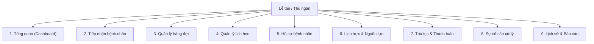
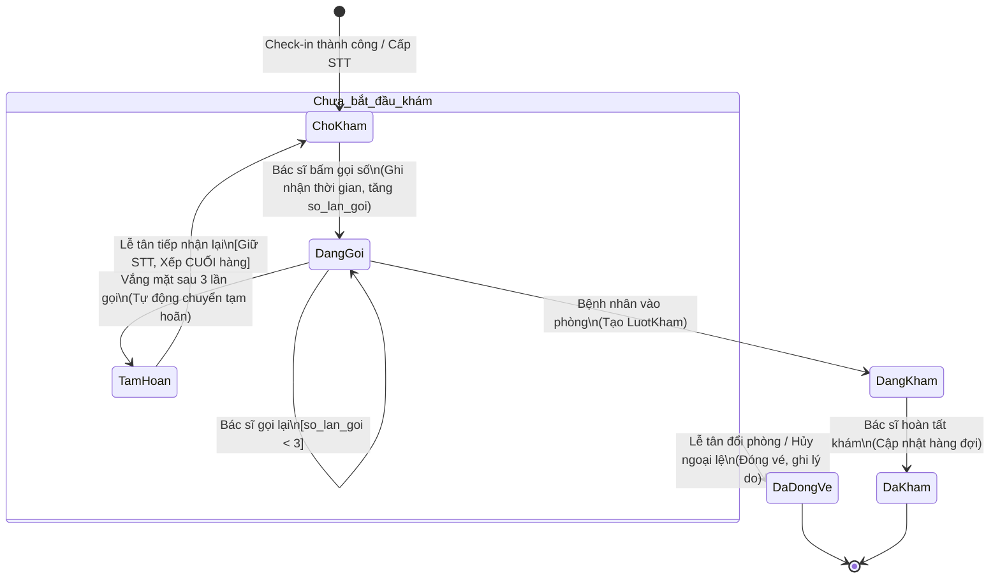
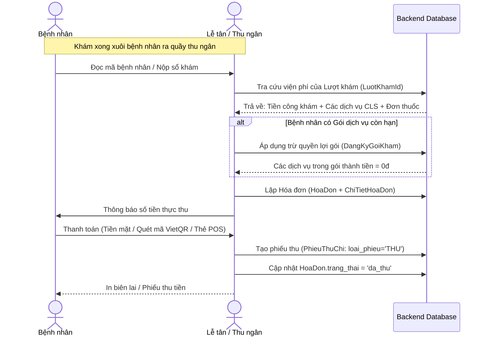

# TÀI LIỆU ĐẶC TẢ CHI TIẾT NGHIỆP VỤ LỄ TÂN & ĐIỀU PHỐI (BACKEND)
> **Dự án:** Clinic-AI Management System  
> **Phân hệ:** Lễ tân — Tiếp đón — Điều phối hàng đợi — Quản lý lịch hẹn — Thu ngân tại quầy  
> **Kiến trúc mục tiêu:** ASP.NET Core (Clean Architecture / Domain-Driven Design)  
> **Đối soát CSDL:** PostgreSQL Schema (`app/models/` & `database/schema_postgresql.sql`)  

---

## MỤC LỤC
1. [Tổng quan & Các nguyên tắc cốt lõi đã thống nhất](#1-tổng-quan--các-nguyên-tắc-cốt-lõi-đã-thống-nhất)
2. [Góp ý hoàn thiện CSDL thực tế](#2-góp-ý-hoàn-thiện-csdl-thực-tế)
3. [Đặc tả chi tiết 9 phân hệ nghiệp vụ (Khớp Menu Frontend)](#3-đặc-tả-chi-tiết-9-phân-hệ-nghiệp-vụ-khớp-menu-frontend)
   - [Mục 1: Tổng quan (Dashboard)](#mục-1-tổng-quan-dashboard)
   - [Mục 2: Tiếp nhận bệnh nhân (Admission & Check-in)](#mục-2-tiếp-nhận-bệnh-nhân-admission--check-in)
   - [Mục 3: Quản lý hàng đợi (Queue State Machine)](#mục-3-quản-lý-hàng-đợi-queue-state-machine)
   - [Mục 4: Quản lý lịch hẹn (Appointment Management)](#mục-4-quản-lý-lịch-hẹn-appointment-management)
   - [Mục 5: Hồ sơ bệnh nhân (Patient Records)](#mục-5-hồ-sơ-bệnh-nhân-patient-records)
   - [Mục 6: Lịch trực & Nguồn lực (Roster & Resources)](#mục-6-lịch-trực--nguồn-lực-roster--resources)
   - [Mục 7: Thủ tục & Thanh toán (Cashier & Invoicing)](#mục-7-thủ-tục--thanh-toán-cashier--invoicing)
   - [Mục 8: Sự cố cần xử lý (Incident Center)](#mục-8-sự-cố-cần-xử-lý-incident-center)
   - [Mục 9: Lịch sử & Báo cáo (Reconciliation & Audit)](#mục-9-lịch-sử--báo-cáo-reconciliation--audit)
4. [Đặc tả Thuật toán Cân bằng tải phân bổ Bác sĩ](#4-đặc-tả-thuật-toán-cân-bằng-tải-phân-bổ-bác-sĩ)
5. [Thiết kế API Endpoints cho ASP.NET Core](#5-thiết-kế-api-endpoints-cho-aspnet-core)

---

## 1. TỔNG QUAN & CÁC NGUYÊN TẮC CỐT LÕI ĐÃ THỐNG NHẤT

Qua quá trình trao đổi và phân tích chuyên sâu, toàn bộ hệ thống vận hành theo các nguyên tắc nghiệp vụ bất biến sau:

1. **Phòng khám tư nhân 100% tự chi trả — KHÔNG CÓ BHYT:** Không xử lý nghiệp vụ tra cứu mã thẻ, tỷ lệ chi trả BHYT hay gửi cổng giám định BHYT.
2. **Khách đặt Online CHƯA TRẢ TIỀN:** Đặt hẹn qua App/Web chỉ mang tính chất giữ chỗ/đăng ký ca khám. Tuyệt đối không thu tiền trước vì chưa xác định được bệnh nhân sẽ làm những dịch vụ cận lâm sàng gì.
3. **Khám xong toàn bộ mới thu tiền (One-Stop Settlement):** Bệnh nhân đến chỉ check-in nhận số vào khám. Sau khi Bác sĩ khám lâm sàng, thực hiện xong các chỉ định cận lâm sàng (nếu có) và kê đơn thuốc $\rightarrow$ Bệnh nhân quay lại quầy Lễ tân (kiêm Thu ngân) để thanh toán gộp 1 lần duy nhất (`HoaDon`).
4. **Thuật toán cân bằng tải bác sĩ (Smart Load Balancing):** Áp dụng cho:
   - Khách vãng lai đến quầy không yêu cầu bác sĩ cụ thể.
   - Khách đặt online chỉ chọn Chuyên khoa và Ca làm việc (Sáng/Chiều) mà không chọn bác sĩ.
   - **Thời điểm kích hoạt:** Chạy chính xác **ngay tại thời điểm Bệnh nhân có mặt tại quầy bấm Check-in** để phân bổ vào Bác sĩ cùng khoa đang có ít người chờ nhất lúc đó.
5. **Lễ tân kiêm vai trò Thu ngân:** Lễ tân trực tiếp lập hóa đơn, thu tiền mặt/chuyển khoản/POS, xuất biên lai và thực hiện khóa sổ bàn giao ca trực (`KhoaSoCaTruc`).
6. **Bệnh nhân tạm hoãn (`TAM_HOAN`) khi tiếp nhận lại $\rightarrow$ XẾP VÀO CUỐI HÀNG:** Giữ nguyên số thứ tự (STT) nhưng cập nhật thời gian xếp hàng lại để đứng sau những người đang chờ hiện tại.

---

## 2. GÓP Ý HOÀN THIỆN CSDL THỰC TẾ

Đối soát giữa CSDL thực tế bạn cung cấp và các nghiệp vụ đã thống nhất, Backend cần bổ sung/điều chỉnh một số thuộc tính sau trong Database để code không bị lỗi logic:

### 2.1. Bảng `lich_kham`
* `bac_si_id`: Hiện tại đang đặt `NOT NULL`.  
  👉 **Cần sửa thành `NULLABLE`**: Vì khách đặt online chỉ chọn Chuyên khoa thì lúc tạo `LichKham` chưa có `bac_si_id` (đến lúc check-in thuật toán mới gán).
* **Bổ sung cột `chuyen_khoa_id` (Integer, FK `chuyen_khoa.id`, NOT NULL):** Để khi khách đặt theo chuyên khoa thì hệ thống biết thuộc khoa nào.
* **Bổ sung cột `ca_kham` (String(20), NOT NULL, Default: 'sang'):** Lưu ca khám ('sang', 'chieu') cho trường hợp khách đặt theo khoa không có giờ cụ thể.
* `gio_kham`: **Cần sửa thành `NULLABLE`** (khi đặt theo khoa chưa có giờ khám chính xác từng phút).

### 2.2. Bảng `hang_doi_kham`
* **Bổ sung cột `thoi_gian_xep_hang_lai` (DateTime(TZ), Nullable):** Ghi nhận thời điểm Lễ tân bấm "Tiếp nhận lại" cho ca bị `TAM_HOAN`. Câu lệnh truy vấn gọi số tiếp theo sẽ ưu tiên xếp ca này xuống cuối hàng.
* **Cập nhật `TrangThaiHangDoiEnum`:** Bổ sung giá trị `DA_DONG_VE` (khớp với sơ đồ trạng thái vòng đời khi hủy/đổi vé).

### 2.3. Bảng `dang_ky_goi_kham` (Theo dõi quyền lợi gói)
* Hiện tại bảng chỉ có `tong_so_dich_vu` và `so_dich_vu_da_dung` (dạng số nguyên tổng).
* 👉 **Góp ý:** Cần có bảng chi tiết **`chi_tiet_su_dung_goi`** (hoặc cột `tien_do_dich_vu_json JSONB`) để lưu rõ: Dịch vụ Siêu âm được 3 lần đã dùng mấy lần, Xét nghiệm máu được 1 lần đã dùng chưa. Nếu không có bảng này, khi bác sĩ chỉ định Siêu âm lần thứ 4 hệ thống sẽ không biết gói đã hết quyền lợi Siêu âm hay chưa.

---

## 3. ĐẶC TẢ CHI TIẾT 9 PHÂN HỆ NGHIỆP VỤ (KHỚP MENU FRONTEND)



---

### MỤC 1: TỔNG QUAN (DASHBOARD)
Màn hình trung tâm hiển thị chỉ số ca trực thời gian thực cho Lễ tân.

#### 1.1. Thống kê lưu lượng ca trực (Shift Metrics)
* **Mô tả:** Lấy tổng số liệu theo ca làm việc hiện tại (`LichLamViec` trong ngày).
* **Nghiệp vụ con:**
  - `GetShiftOverview`:
    - Tổng hẹn trước trong ca (từ `LichKham` trạng thái `da_xac_nhan`).
    - Số ca đã check-in thành công (`da_tiep_nhan`).
    - Số ca đang chờ khám (`HangDoiKham` trạng thái `cho_kham`).
    - Số ca đang khám (`dang_kham`) và đã khám xong (`da_kham`).
    - Số ca vắng mặt / tạm hoãn (`tam_hoan`) và bỏ khám (`bo_kham`).
    - Số ca vãng lai tiếp nhận trực tiếp tại quầy.

#### 1.2. Giám sát tải buồng khám (Room Utilization)
* **Mô tả:** Hiển thị trực quan từng phòng khám (`PhongKham`) đang mở trong ca:
  - Bác sĩ nào đang ngồi trực.
  - Số bệnh nhân đang chờ trước cửa phòng.
  - Cảnh báo màu vàng/đỏ nếu số lượng chờ $> 5$ người.

#### 1.3. Cảnh báo khẩn cấp (Real-time Alerts)
* Cảnh báo lịch hẹn trễ giờ check-in quá 15 phút.
* Cảnh báo sự cố buồng khám / bác sĩ chưa xử lý.

---

### MỤC 2: TIẾP NHẬN BỆNH NHÂN (ADMISSION & CHECK-IN)
Nơi làm việc tần suất cao nhất của Lễ tân tại quầy đón tiếp.

#### 2.1. Tiếp nhận Check-in Bệnh nhân Đã Đặt Lịch Online
* **Luồng xử lý:**
  1. Lễ tân quét mã QR `ma_lich_kham` trên điện thoại của bệnh nhân hoặc tìm theo SĐT.
  2. Hệ thống kiểm tra `LichKham`: Phải ở trạng thái `da_xac_nhan`, đúng ngày hôm nay và đúng ca trực.
  3. **Phân bổ Bác sĩ (Xử lý 2 nhánh):**
     - *Nhánh A (Bệnh nhân đã chọn đích danh Bác sĩ khi đặt):* Lấy trực tiếp `bac_si_id` từ `LichKham`.
     - *Nhánh B (Bệnh nhân chỉ đặt theo Chuyên khoa):* Backend tự động kích hoạt **Thuật toán cân bằng tải** $\rightarrow$ Tìm bác sĩ cùng chuyên khoa có ít người chờ nhất lúc này $\rightarrow$ Gán `bac_si_id` vào `LichKham`.
  4. Cập nhật `LichKham`: Chuyển `trang_thai = 'da_tiep_nhan'`, ghi nhận `thoi_gian_xac_nhan = now()`.
  5. Sinh bản ghi vào **`HangDoiKham`**:
     - `loai_hang_doi`: Phân loại tự động dựa trên giờ đến (`dung_hen`, `den_som`, `den_muon`).
     - `so_thu_tu_kham`: Cấp số tự tăng trong ca trực của phòng đó.
     - `muc_do_uu_tien`: Mặc định = 2 (Đúng hẹn).
     - `trang_thai`: `'cho_kham'`.
     - `thoi_gian_check_in`: `DateTime.UtcNow`.
     - `nguoi_tiep_nhan_id`: ID tài khoản lễ tân đang đăng nhập.
  6. **TUYỆT ĐỐI KHÔNG THU TIỀN Ở BƯỚC NÀY.**
  7. In phiếu số thứ tự cho bệnh nhân (gồm: Mã BN, Tên BN, STT, Phòng khám, Tên Bác sĩ).

#### 2.2. Tiếp nhận Khách Vãng Lai (Walk-in Admission)
* **Luồng xử lý:**
  1. Lễ tân tìm kiếm hồ sơ `BenhNhan`. Nếu chưa có $\rightarrow$ chuyển sang [Mục 5.2](#52-đăng-ký-mới-hồ-sơ-bệnh-nhân) để tạo mới trong 30 giây.
  2. Bệnh nhân nêu triệu chứng / Chuyên khoa mong muốn khám.
  3. Lễ tân chọn Chuyên khoa $\rightarrow$ Backend kiểm tra hạn mức:
     - Đọc ca trực `LichLamViec` của các bác sĩ thuộc khoa đó.
     - Kiểm tra điều kiện: $\sum(\text{soLuongVangLaiDaTiepNhan}) < \sum(\text{han\_muc\_vang\_lai})$.
     - Nếu đã hết sạch chỉ tiêu vãng lai $\rightarrow$ Báo lỗi trên màn hình để lễ tân tư vấn chuyển ca sau hoặc đăng ký `DanhSachCho`.
  4. Nếu còn chỗ $\rightarrow$ Chạy thuật toán Cân bằng tải gán Bác sĩ có hàng chờ ngắn nhất.
  5. Sinh bản ghi vào `HangDoiKham`:
     - `lich_kham_id` = `NULL`.
     - `loai_hang_doi` = `'vang_lai'`.
     - `muc_do_uu_tien` = 5 (Vãng lai).
     - `trang_thai` = `'cho_kham'`.
  6. In phiếu STT vãng lai.

#### 2.3. Tiếp nhận Diện Ưu Tiên (Emergency / Priority Queue)
* Áp dụng khi tiếp nhận: Cấp cứu nhẹ, Thương binh, Người già $\ge 80$ tuổi, Trẻ sơ sinh $\le 6$ tháng, Phụ nữ mang thai chuyển dạ.
* Lễ tân tích chọn lý do ưu tiên $\rightarrow$ Gán `muc_do_uu_tien = 1` (Cấp cứu) hoặc nâng bậc ưu tiên.
* Hệ thống tự động đẩy vé này lên đầu danh sách chờ của bác sĩ.

---

### MỤC 3: QUẢN LÝ HÀNG ĐỢI (QUEUE STATE MACHINE)
Hiện thực hóa chính xác máy trạng thái vòng đời của phiếu khám theo sơ đồ bạn đã cung cấp.



#### 3.1. Nghiệp vụ Bác sĩ gọi số & Tự động Tạm hoãn
* Bác sĩ bấm "Gọi số" trên màn hình phòng khám $\rightarrow$ Chuyển sang `dang_kham` tạm thời hoặc trạng thái gọi loa:
  - Tăng `so_lan_goi = so_lan_goi + 1`.
  - Ghi nhận `thoi_gian_goi_kham = now()`.
  - Phát âm thanh gọi số lên loa sảnh và hiển thị LCD.
* Nếu gọi 3 lần mà bệnh nhân không vào $\rightarrow$ Hệ thống tự động chuyển sang `tam_hoan`. Bác sĩ được phép gọi bệnh nhân tiếp theo.

#### 3.2. Lễ tân Tiếp nhận lại vé Tạm hoãn (Re-open Hold Ticket)
* **Bối cảnh:** Bệnh nhân đi vệ sinh, làm thủ tục quay lại quầy gặp lễ tân xin khám lại.
* **Luồng xử lý Backend:**
  1. Lễ tân tìm vé đang ở trạng thái `tam_hoan`.
  2. Bấm nút **"Tiếp nhận lại"**.
  3. Cập nhật bản ghi `HangDoiKham`:
     - Chuyển `trang_thai = 'cho_kham'`.
     - Cập nhật `thoi_gian_xep_hang_lai = DateTime.UtcNow`.
     - Reset `so_lan_goi = 0`.
     - Giữ nguyên `so_thu_tu_kham` ban đầu.
  4. **Thuật toán sắp xếp thứ tự hiển thị của Bác sĩ (SQL Order By):**
     ```sql
     ORDER BY 
       hang_doi_kham.muc_do_uu_tien ASC,
       COALESCE(hang_doi_kham.thoi_gian_xep_hang_lai, hang_doi_kham.thoi_gian_check_in) ASC
     ```
     *(Nhờ câu lệnh này, bệnh nhân tạm hoãn có mốc thời gian mới nhất nên sẽ tự động trôi xuống **CUỐI CÙNG** của danh sách những người đang chờ).*

#### 3.3. Đổi buồng khám / Đóng vé ngoại lệ (`DaDongVe` / `BoKham`)
* **Trường hợp Bệnh nhân xin bỏ về:** Lễ tân chọn vé $\rightarrow$ Chọn lý do (chờ lâu, có việc bận) $\rightarrow$ Chuyển `trang_thai = 'bo_kham'` (`DA_DONG_VE`).
* **Trường hợp Đổi buồng khám:** Lễ tân chọn vé $\rightarrow$ Chọn phòng khám đích $\rightarrow$ Chuyển vé sang ca trực của Bác sĩ mới với STT mới.

---

### MỤC 4: QUẢN LÝ LỊCH HẸN (APPOINTMENT MANAGEMENT)

#### 4.1. Đặt lịch hẹn mới tại quầy / Hotline
* **Đầu vào:** `benh_nhan_id`, ngày hẹn, ca hẹn ('sang' / 'chieu'), chuyên khoa, bác sĩ (tùy chọn), lý do khám.
* **Xử lý:**
  - Kiểm tra `so_lan_no_show` của bệnh nhân: Nếu $\ge 2$ lần và `is_blocked_booking = True` $\rightarrow$ Chặn đặt online, chỉ cho phép lễ tân bảo lãnh mở khóa đặt trực tiếp.
  - Kiểm tra slot ca trực: Không vượt quá `han_muc_dat_truoc`.
  - Sinh mã `ma_lich_kham` (dạng `LK-YYYYMMDD-XXXX`).
  - Lưu bản ghi `LichKham` trạng thái `da_xac_nhan`. **Chưa thu tiền.**

#### 4.2. Quản lý Danh sách chờ thông minh (`DanhSachCho` - Waitlist)
* Khi ca khám của một bác sĩ đã kín chỗ:
  - Bệnh nhân đăng ký vào danh sách chờ: Ghi nhận vào `DanhSachCho` với `thu_tu_uu_tien`.
  - Khi có một bệnh nhân khác hủy lịch (`da_huy`) $\rightarrow$ Hệ thống tự động bắn thông báo cho người đứng đầu Waitlist, giữ slot trong 15 phút.
  - Nếu bệnh nhân xác nhận $\rightarrow$ Chuyển đổi thành bản ghi `LichKham` chính thức.

#### 4.3. Dời lịch (Reschedule) & Hủy lịch (Cancel)
* **Dời lịch:** Chuyển sang ngày/ca mới, tự động trừ slot ca mới và hoàn lại slot cho ca cũ.
* **Hủy lịch:** Cập nhật `trang_thai = 'da_huy'`, lưu `thoi_gian_huy`, `ly_do_huy`, `nguoi_huy_vai_tro = 'le_tan'`. Tăng lại hạn mức đặt trước cho ca trực.

---

### MỤC 5: HỒ SƠ BỆNH NHÂN (PATIENT RECORDS)

#### 5.1. Tra cứu thông tin bệnh nhân
* Tìm kiếm theo: Số điện thoại (chính xác), Số CCCD, Họ tên (Full-text search), Mã bệnh nhân (`BN-XXXX`).

#### 5.2. Đăng ký mới hồ sơ bệnh nhân
* Tạo cùng lúc bản ghi `NguoiDung` (thông tin cá nhân cơ bản) và `BenhNhan`.
* Tự động sinh `ma_dinh_danh_y_te`.
* Lưu các cảnh báo quan trọng: `nhom_mau`, `tien_su_benh`, đặc biệt là **`di_ung_thuoc`** (Hiển thị nhãn đỏ cảnh báo khi tiếp đón).

#### 5.3. Quản lý Hồ sơ người thân (`HoSoNguoiThan`)
* Một tài khoản cha/mẹ có thể quản lý nhiều hồ sơ con cái / người già phụ thuộc.
* Khi tiếp đón, Lễ tân chọn rõ: Người khám là Chủ tài khoản hay Người thân đi cùng để gán đúng bệnh nhân vào lượt khám.

#### 5.4. Tra cứu Gói khám của Bệnh nhân (`DangKyGoiKham`)
* Xem bệnh nhân đang có những gói dịch vụ nào còn hiệu lực (`trang_thai = 'DANG_SU_DUNG'`, `han_su_dung >= now()`).
* Xem chi tiết số lượng dịch vụ đã dùng / còn lại để giải thích quyền lợi cho bệnh nhân.

---

### MỤC 6: LỊCH TRỰC & NGUỒN LỰC (ROSTER & RESOURCES)

#### 6.1. Giám sát ca trực thực tế (`LichLamViec`)
* Xem danh sách phân công bác sĩ theo từng buồng khám trong ngày.
* Theo dõi các chỉ số lấp đầy: `han_muc_dat_truoc`, `han_muc_vang_lai`, số lượng thực tế đã check-in.

#### 6.2. Xem Roster mẫu định kỳ (`LichDinhKyBacSi`)
* Tra cứu lịch làm việc cố định hàng tuần của các Bác sĩ để tư vấn lịch khám cho khách gọi hotline.

#### 6.3. Giám sát trạng thái Buồng khám vật lý (`PhongKham`)
* Xem trạng thái phòng: Đang mở khám, Tạm nghỉ, hay Đang bảo trì thiết bị (`is_active`).

---

### MỤC 7: THỦ TỤC & THANH TOÁN (CASHIER & INVOICING)
*Nghiệp vụ Thu ngân thực hiện sau khi Bác sĩ đã hoàn tất khám lâm sàng và chỉ định cận lâm sàng.*



#### 7.1. Tổng hợp viện phí ca khám (Bill Consolidation)
* Backend tổng hợp chi phí từ các nguồn gắn với `LuotKham`:
  1. **Công khám bác sĩ:** Lấy từ `BacSi.gia_kham_mac_dinh` (nếu chưa có gói bao gồm công khám).
  2. **Dịch vụ Cận lâm sàng phát sinh:** Các xét nghiệm, chụp chiếu bác sĩ chỉ định.
  3. **Thuốc:** Tiền đơn thuốc nếu lấy thuốc tại nhà thuốc của phòng khám.
  4. **Gói khám mua mới:** Nếu bệnh nhân đăng ký mua thêm gói khám tại quầy.

#### 7.2. Đối soát & Khấu trừ Quyền lợi Gói khám
* Hệ thống tự động so khớp các dịch vụ bác sĩ vừa chỉ định với danh mục quyền lợi trong `DangKyGoiKham` của bệnh nhân:
  - Nếu dịch vụ nằm trong gói và còn hạn mức $\rightarrow$ Đơn giá tính vào hóa đơn = 0đ, tăng `so_dich_vu_da_dung` của gói lên 1.
  - Nếu dịch vụ phát sinh ngoài gói $\rightarrow$ Tính theo đơn giá niêm yết của `DichVu`.

#### 7.3. Lập Hóa đơn (`HoaDon`) & Chi tiết hóa đơn (`ChiTietHoaDon`)
* Sinh mã `ma_hoa_don` (dạng `HD-YYYYMMDD-XXXX`).
* Tách từng dòng chi tiết vào `ChiTietHoaDon` theo đúng `loai_muc`: `'cong_kham'`, `'can_lam_sang'`, `'thuoc'`, `'vat_tu'`.
* Tính toán: `tong_tien`, `mien_giam`, `thuc_thu = tong_tien - mien_giam`.

#### 7.4. Ghi nhận Thanh toán & Lập Phiếu Thu (`PhieuThuChi`)
* Hỗ trợ đa phương thức: `tien_mat`, `chuyen_khoan` (VietQR động), `pos`.
* Cập nhật `HoaDon.trang_thai = 'da_thu'`, `ngay_thanh_toan = now()`.
* Tự động sinh bản ghi **`PhieuThuChi`**:
  - `loai_phieu = 'THU'`.
  - `hoa_don_id` liên kết.
  - `so_tien = thuc_thu`.
  - `nhan_vien_id` = ID của Lễ tân/Thu ngân thu tiền.
  - `trang_thai_khoa_so = False`.

---

### MỤC 8: SỰ CỐ CẦN XỬ LÝ (INCIDENT CENTER)

#### 8.1. Sự cố: Bác sĩ nghỉ đột xuất (`NghiPhepBacSi`)
* **Trigger:** Đơn nghỉ phép đột xuất của Bác sĩ được duyệt (`loai_nghi = 'NGHI_DOT_XUAT'`).
* **Backend xử lý tự động:**
  1. Đóng ca trực của bác sĩ: `LichLamViec.is_active = False`, ghi `ghi_chu_nghi`.
  2. **Xử lý bệnh nhân đang ngồi chờ tại phòng:**
     - Quét toàn bộ `HangDoiKham` trạng thái `cho_kham` của bác sĩ nghỉ.
     - Kích hoạt thuật toán Re-balance: Tự động phân bổ lại sang các Bác sĩ khác cùng chuyên khoa đang trực ca đó.
     - Bắn thông báo Realtime lên màn hình sảnh.
  3. **Xử lý bệnh nhân đã đặt hẹn online trước:**
     - Lọc toàn bộ `LichKham` bị ảnh hưởng $\rightarrow$ Cập nhật `so_lich_anh_huong` vào đơn nghỉ phép.
     - Đưa danh sách lên màn hình "Sự cố cần xử lý" để Lễ tân gọi điện xin lỗi bệnh nhân, hỗ trợ dời lịch hoặc đổi bác sĩ.

#### 8.2. Sự cố: Phòng khám / Thiết bị bảo trì đột xuất
* **Trigger:** Lễ tân/Quản lý cập nhật `PhongKham.is_active = False` hoặc máy móc hỏng.
* **Backend xử lý:**
  - Chuyển toàn bộ các ca trực `LichLamViec` tại phòng đó sang buồng khám dự phòng trống.
  - Tự động đổi `phong_thuc_hien_id` của các dịch vụ cận lâm sàng đang chờ sang phòng khác có thiết bị tương đương.

#### 8.3. Sự cố: Xử lý Hủy dịch vụ & Hoàn tiền (Refund)
* **Bối cảnh:** Bệnh nhân đã thanh toán tiền xét nghiệm nhưng có việc gấp xin không làm nữa và yêu cầu hoàn tiền.
* **Xử lý:**
  - Hủy dòng dịch vụ chưa thực hiện.
  - Lập bản ghi **`PhieuThuChi` loại `'CHI'`**:
    - `loai_phieu = 'CHI'`.
    - `so_tien` = Số tiền hoàn trả.
    - `ly_do` = Ghi rõ lý do hoàn tiền.
    - `nhan_vien_id` = Lễ tân thực hiện hoàn tiền.

---

### MỤC 9: LỊCH SỬ & BÁO CÁO (RECONCILIATION & AUDIT)

#### 9.1. Khóa sổ ca trực & Bàn giao tiền mặt (`KhoaSoCaTruc`)
* Cuối mỗi ca làm việc (trước khi ra về hoặc giao ca cho người sau), Lễ tân/Thu ngân bắt buộc phải thực hiện khóa sổ:
* **Quy trình Backend:**
  1. Hệ thống tự động tính toán tổng số tiền phát sinh trong ca của thu ngân đó:
     - `tong_tien_mat_he_thong = SUM(so_tien)` từ các phiếu thu tiền mặt trong ca.
     - `tong_chuyen_khoan_he_thong = SUM(so_tien)` từ chuyển khoản ngân hàng.
     - `tong_the_pos_he_thong = SUM(so_tien)` từ quẹt thẻ POS.
     - `tong_so_phieu_thu`, `tong_so_phieu_chi`.
  2. Thu ngân đếm tiền mặt thực tế trong két và nhập: `tien_mat_thuc_te`.
  3. Hệ thống tính: `chenh_lech_tien_mat = tien_mat_thuc_te - tong_tien_mat_he_thong`.
  4. Nếu có chênh lệch, thu ngân bắt buộc nhập `ghi_chu` giải trình.
  5. Tạo bản ghi `KhoaSoCaTruc` trạng thái `'DA_KHOA_SO'`.
  6. Khóa toàn bộ các `PhieuThuChi` trong ca: `trang_thai_khoa_so = True` (chống chỉnh sửa dữ liệu tài chính lịch sử).

#### 9.2. Báo cáo Bệnh nhân vắng mặt (No-Show Audit)
* Cuối ca trực, Backend chạy job quét toàn bộ các `LichKham` trạng thái `da_xac_nhan` mà không đến check-in:
  - Chuyển `trang_thai = 'no_show'`.
  - Tăng `BenhNhan.so_lan_no_show = so_lan_no_show + 1`.
  - Trừ `diem_tin_nhiem`.
  - Nếu `so_lan_no_show >= 2` $\rightarrow$ Tự động bật `is_blocked_booking = True` (Khóa tài khoản đặt online).

---

## 4. ĐẶC TẢ THUẬT TOÁN CÂN BẰNG TẢI PHÂN BỔ BÁC SĨ

Thuật toán được hiện thực hóa tại `DoctorLoadBalancingService` trên Backend ASP.NET Core:

```csharp
public async Task<int> AssignOptimalDoctorAsync(int chuyenKhoaId, string caKham, DateTime ngayKham)
{
    // 1. Lọc tất cả ca trực đang mở của Chuyên khoa trong ca hiện tại
    var activeShifts = await _context.LichLamViec
        .Include(s => s.BacSi)
        .Where(s => s.BacSi.ChuyenKhoaId == chuyenKhoaId
                 && s.NgayLamViec == ngayKham.Date
                 && s.CaLamViec == caKham
                 && s.IsActive == true)
        .ToListAsync();

    if (!activeShifts.Any())
        throw new BusinessException("Khoa hiện không có Bác sĩ nào đang trực ca này.");

    // 2. Loại trừ bác sĩ có đơn nghỉ phép đột xuất đã duyệt
    var availableShifts = activeShifts.Where(s => 
        !_context.NghiPhepBacSi.Any(np => np.BacSiId == s.BacSiId 
                                       && np.TrangThai == "DA_DUYET"
                                       && np.TuNgay <= ngayKham.Date 
                                       && np.DenNgay >= ngayKham.Date)).ToList();

    if (!availableShifts.Any())
        throw new BusinessException("Tất cả bác sĩ trong khoa đều bận hoặc nghỉ phép.");

    // 3. Tính toán tải thực tế hiện tại của từng Bác sĩ (Số người đang chờ trong hàng đợi)
    var doctorLoads = new List<(int BacSiId, int CurrentLoad, DateTime? LastAssignedTime)>();

    foreach (var shift in availableShifts)
    {
        // Tải = Số người đang chờ khám (cho_kham) + Số người đang được gọi (dang_kham)
        int currentQueueCount = await _context.HangDoiKham
            .CountAsync(q => q.BacSiId == shift.BacSiId
                          && q.NgayKham == ngayKham.Date
                          && q.CaKham == caKham
                          && (q.TrangThai == "cho_kham" || q.TrangThai == "dang_kham"));

        var lastAssigned = await _context.HangDoiKham
            .Where(q => q.BacSiId == shift.BacSiId && q.NgayKham == ngayKham.Date)
            .OrderByDescending(q => q.ThoiGianCheckIn)
            .Select(q => (DateTime?)q.ThoiGianCheckIn)
            .FirstOrDefaultAsync();

        doctorLoads.Add((shift.BacSiId, currentQueueCount, lastAssigned));
    }

    // 4. Lựa chọn Bác sĩ tối ưu nhất:
    // - Ưu tiên 1: Bác sĩ có số lượng người chờ ít nhất (Min Queue Count)
    // - Ưu tiên 2 (Tie-breaker): Bác sĩ có thời gian tiếp nhận ca gần nhất xa nhất (Round-robin công bằng)
    var optimalDoctor = doctorLoads
        .OrderBy(d => d.CurrentLoad)
        .ThenBy(d => d.LastAssignedTime ?? DateTime.MinValue)
        .First();

    return optimalDoctor.BacSiId;
}
```

---

## 5. THIẾT KẾ API ENDPOINTS CHO ASP.NET CORE

Toàn bộ hệ thống API cho Lễ tân được nhóm theo 9 Controller tương ứng với 9 phân hệ:

| Controller | HTTP Method & Route | Nghiệp vụ thực thi |
| :--- | :--- | :--- |
| **`DashboardController`** | `GET /api/v1/reception/dashboard/shift-summary` | Lấy các chỉ số tổng quan ca trực |
| | `GET /api/v1/reception/dashboard/room-status` | Lấy danh sách tải các buồng khám |
| **`AdmissionController`** | `POST /api/v1/reception/admission/checkin-appointment` | Check-in lịch hẹn online (chạy cân bằng tải nếu chưa có BS) |
| | `POST /api/v1/reception/admission/checkin-walkin` | Tiếp nhận vãng lai $\rightarrow$ Cân bằng tải gán BS $\rightarrow$ Cấp STT |
| **`QueueController`** | `GET /api/v1/reception/queues?bacSiId=...&caKham=...` | Xem danh sách hàng đợi theo phòng/ca |
| | `PATCH /api/v1/reception/queues/{id}/reopen` | Tiếp nhận lại vé `TAM_HOAN` $\rightarrow$ Xếp vào cuối hàng |
| | `PATCH /api/v1/reception/queues/{id}/close` | Đóng vé / Hủy hàng đợi ngoại lệ |
| | `PATCH /api/v1/reception/queues/{id}/transfer` | Đổi buồng khám / Bác sĩ |
| **`AppointmentController`**| `GET /api/v1/reception/appointments` | Danh sách lịch hẹn (lọc theo ngày, khoa, BS, trạng thái) |
| | `POST /api/v1/reception/appointments` | Đặt lịch hẹn hộ qua hotline/tại quầy |
| | `PATCH /api/v1/reception/appointments/{id}/reschedule`| Dời ngày/giờ hẹn |
| | `PATCH /api/v1/reception/appointments/{id}/cancel` | Hủy lịch hẹn (kèm lý do) |
| **`PatientController`** | `GET /api/v1/reception/patients?search=...` | Tìm kiếm hồ sơ BN theo SĐT, CCCD, Mã BN |
| | `POST /api/v1/reception/patients` | Đăng ký hồ sơ bệnh nhân mới |
| | `GET /api/v1/reception/patients/{id}/packages` | Xem danh sách gói khám còn hạn của bệnh nhân |
| **`ResourceController`** | `GET /api/v1/reception/resources/roster` | Xem lịch trực phân công nhân viên |
| | `GET /api/v1/reception/resources/rooms` | Danh sách buồng khám và thiết bị |
| **`BillingController`** | `GET /api/v1/reception/billing/encounters/{luotKhamId}/statement` | Tổng hợp toàn bộ viện phí chưa thu của ca khám |
| | `POST /api/v1/reception/billing/invoices` | Lập hóa đơn thanh toán viện phí |
| | `POST /api/v1/reception/billing/invoices/{id}/pay` | Xác nhận thu tiền $\rightarrow$ Tự động sinh `PhieuThuChi` |
| **`IncidentController`** | `GET /api/v1/reception/incidents/doctor-absences` | Xem danh sách bác sĩ nghỉ đột xuất cần xử lý |
| | `POST /api/v1/reception/incidents/rebalance-queue` | Phân bổ lại hàng đợi của bác sĩ nghỉ sang bác sĩ khác |
| | `POST /api/v1/reception/billing/refund` | Lập phiếu chi hoàn tiền dịch vụ |
| **`ReconciliationController`**| `GET /api/v1/reception/reconciliation/current-shift` | Xem doanh thu tạm tính trong ca |
| | `POST /api/v1/reception/reconciliation/close-shift` | Khóa sổ ca trực & Bàn giao tiền mặt (`KhoaSoCaTruc`) |

---

## TỔNG KẾT
Tài liệu này đã bao quát toàn diện **100% các điểm thảo luận** giữa bạn và tôi, hoàn toàn ăn khớp với cấu trúc Database PostgreSQL thực tế, sơ đồ State Machine hàng đợi và 9 module trên giao diện Frontend. Bạn có thể sử dụng trực tiếp file này làm kim chỉ nam để xây dựng các Entity, Service và Controller trên ASP.NET Core!
