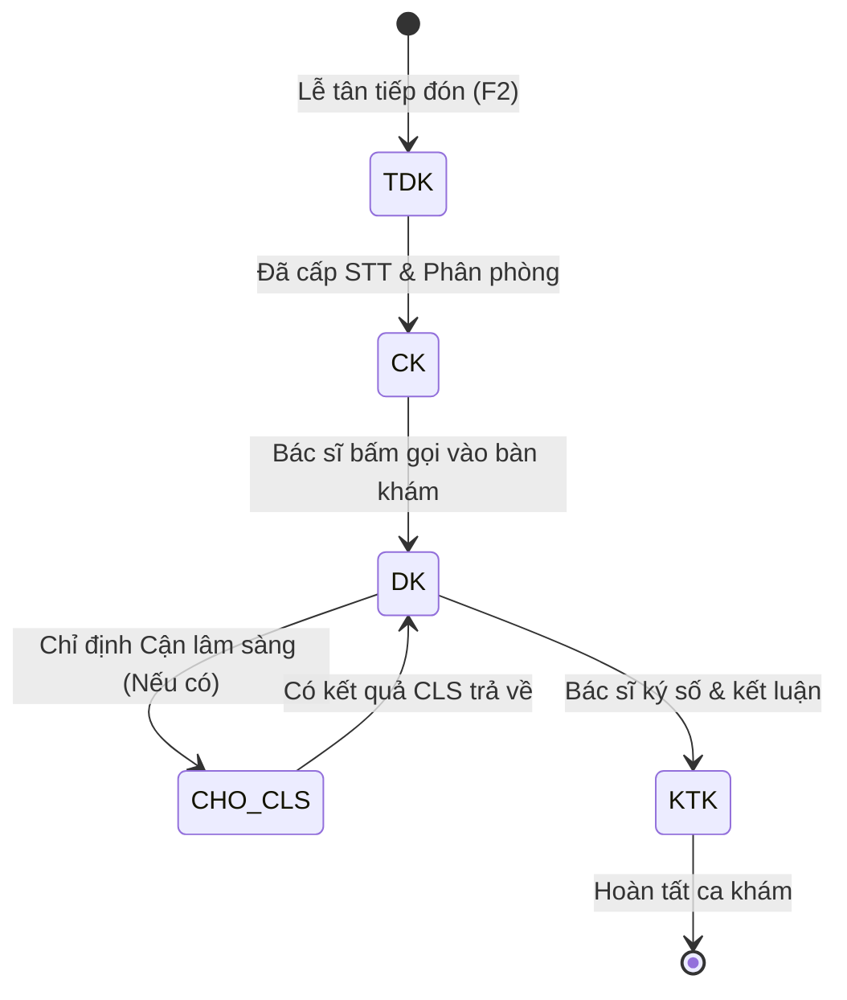
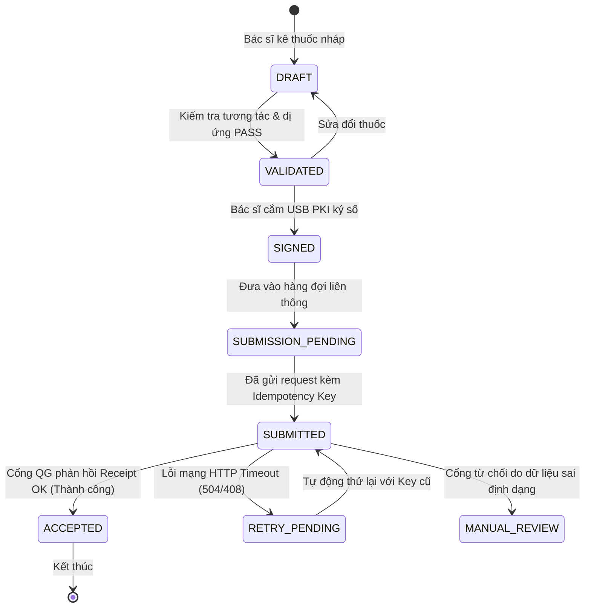

# ĐẶC TẢ NGHIỆP VỤ PHÒNG KHÁM THỰC TẾ — TCLINIC & NỀN TẢNG CLINIC-AI

**Tác giả:** Đội ngũ Phát triển Nền tảng Clinic-AI  
**Nguồn tham chiếu nghiệp vụ:** Hệ thống thực tế [tClinic.io](https://demo.tclinic.io/) & Chuẩn trải nghiệm Y tế Medpro.vn  
**Căn cứ pháp lý y tế Việt Nam:** Luật Khám bệnh, chữa bệnh số 15/2023/QH15, Nghị định 96/2023/NĐ-CP, Thông tư 26/2025/TT-BYT, Thông tư 13/2025/TT-BYT, Thông tư 32/2023/TT-BYT, Nghị định 102/2025/NĐ-CP, Luật Bảo vệ dữ liệu cá nhân 91/2025/QH15.  
**Phiên bản tài liệu:** 2.0 — Tài liệu Kỹ thuật & Nghiệp vụ Hoàn chỉnh phục vụ Đồ án và Vận hành Thực tế.

---

## MỤC LỤC

1. [TỔNG QUAN HỆ THỐNG VÀ ĐỐI CHIẾU KIẾN TRÚC](#1-tổng-quan-hệ-thống-và-đối-chiếu-kiến-trúc)
2. [MA TRẬN PHÂN ĐỊNH TRÁCH NHIỆM VAI TRÒ (RACI MATRIX)](#2-ma-trận-phân-định-trách-nhiệm-vai-trò-raci-matrix)
3. [ĐẶC TẢ CHI TIẾT 12 PHÂN HỆ NGHIỆP VỤ THỰC TẾ](#3-đặc-tả-chi-tiết-12-phân-hệ-nghiệp-vụ-thực-tế)
   - [Phân hệ 1: Bàn làm việc Đa vai trò (Role Workbenches)](#phân-hệ-1-bàn-làm-việc-đa-vai-trò-role-workbenches)
   - [Phân hệ 2: Tiếp đón & Đăng ký Khám bệnh Tốc độ cao](#phân-hệ-2-tiếp-đón--đăng-ký-khám-bệnh-tốc-độ-cao)
   - [Phân hệ 3: AI Phân luồng Chuyên khoa (AI Specialty Triage)](#phân-hệ-3-ai-phân-luồng-chuyên-khoa-ai-specialty-triage)
   - [Phân hệ 4: Khám lâm sàng & Đánh giá Sức khỏe Toàn diện](#phân-hệ-4-khám-lâm-sàng--đánh-giá-sức-khỏe-toàn-diện)
   - [Phân hệ 5: Chỉ định & Trả kết quả Cận lâm sàng (CLS / PACS / LIS)](#phân-hệ-5-chỉ-định--trả-kết-quả-cận-lâm-sàng-cls--pacs--lis)
   - [Phân hệ 6: Quản lý Dịch vụ Mở rộng (Gói khám, Liệu trình, Đoàn B2B)](#phân-hệ-6-quản-lý-dịch-vụ-mở-rộng-gói-khám-liệu-trình-đoàn-b2b)
   - [Phân hệ 7: Quản lý Thu chi Viện phí & Khóa sổ Ca trực](#phân-hệ-7-quản-lý-thu-chi-viện-phí--khóa-sổ-ca-trực)
   - [Phân hệ 8: Quản trị Kho Dược & Vật tư Y tế (FEFO & Số Lô)](#phân-hệ-8-quản-trị-kho-dược--vật-tư-y-tế-fefo--số-lô)
   - [Phân hệ 9: Cổng Liên thông Đơn thuốc Quốc gia (TT 26/2025)](#phân-hệ-9-cổng-liên-thông-đơn-thuốc-quốc-gia-tt-262025)
   - [Phân hệ 10: Cổng Liên thông Cơ sở Dữ liệu Dược Quốc gia](#phân-hệ-10-cổng-liên-thông-cơ-sở-dữ-liệu-dược-quốc-gia)
   - [Phân hệ 11: Cổng Liên thông Sổ Sức khỏe Điện tử (HSSK)](#phân-hệ-11-cổng-liên-thông-sổ-sức-khỏe-điện-tử-hssk)
   - [Phân hệ 12: Bệnh án Điện tử Bất biến & Nhật ký Kiểm toán](#phân-hệ-12-bệnh-án-điện-tử-bất-biến--nhật-ký-kiểm-toán)
4. [MÔ HÌNH DỮ LIỆU & RÀNG BUỘC TOÀN VẸN (DATA MODEL & INVARIANTS)](#4-mô-hình-dữ-liệu--ràng-buộc-toàn-vẹn-data-model--invariants)
5. [CÁC MÁY TRẠNG THÁI HỮU HẠN CỐT LÕI (STATE MACHINES)](#5-các-máy-trạng-thái-hữu-hạn-cốt-lõi-state-machines)
6. [PHÂN TÍCH TÍNH KHẢ THI TRIỂN KHAI TẠI PHÒNG KHÁM VIỆT NAM](#6-phân-tích-tính-khả-thi-triển-khai-tại-phòng-khám-việt-nam)

---

# 1. TỔNG QUAN HỆ THỐNG VÀ ĐỐI CHIẾU KIẾN TRÚC

## 1.1. Bối cảnh Nghiệp vụ Thực tế
Trong các cơ sở khám chữa bệnh ngoài công lập (phòng khám đa khoa, chuyên khoa) tại Việt Nam, phần mềm quản lý phòng khám (HIS - Hospital Information System) không đơn thuần là một bảng ghi dữ liệu tĩnh. Hệ thống phải phục vụ áp lực vận hành cực cao tại quầy tiếp đón (thao tác dưới 30 giây/bệnh nhân), liên kết dữ liệu thời gian thực giữa Bác sĩ - Điều dưỡng - Kế toán - Dược sĩ, và đặc biệt phải **tuân thủ nghiêm ngặt lộ trình số hóa y tế bắt buộc của Bộ Y tế** có hiệu lực giai đoạn 2024–2026.

Khảo sát hệ thống thực tế **tClinic** (phiên bản triển khai tại Phòng khám Đa khoa Quang Lâm - `demo.tclinic.io`) cho thấy:
- Hệ thống chia làm **7 menu điều hành nhanh** trên Topbar và **15 module chuyên sâu** trên Sidebar.
- Giao diện tối ưu hóa cho từng vị trí nhân sự với thao tác bàn phím (Phím tắt F2, F5, F7, F8, F9).
- Tích hợp sẵn các phân mục liên thông Cổng Quốc gia: Đơn thuốc điện tử, Dược quốc gia, và Sổ sức khỏe điện tử (HSSK).

## 1.2. Sứ mệnh của Nền tảng Clinic-AI
Dự án **Clinic-AI** kế thừa toàn bộ các luồng nghiệp vụ thực tiễn sâu sắc từ **tClinic**, đồng thời nâng cấp trải nghiệm người dùng theo ngôn ngữ thiết kế chuẩn mực của **Medpro.vn** (Hệ thống đặt khám y tế số 1 Việt Nam):
1. **Thiết kế thân thiện, nhận diện chuẩn Medpro**: Màu xanh chủ đạo `#00B5F1`, xanh navy `#003553`, nền xanh dịu `#E8F4FD`, điểm nhấn cam y tế `#FFB54A`, hệ thống icon trực quan từ thư viện chuyên nghiệp `@phosphor-icons/react`.
2. **Trợ lý AI Phân luồng Chuyên khoa (AI Triage)**: Hỗ trợ Lễ tân tiếp đón gợi ý đúng chuyên khoa khám dựa trên triệu chứng sơ bộ, **tuyệt đối không chẩn đoán bệnh thay bác sĩ**, đảm bảo an toàn pháp lý y khoa.
3. **Lớp Quản lý Tuân thủ Pháp lý & Kiểm toán Bất biến (Compliance & Audit Layer)**: Đảm bảo tính bất biến (Append-only) của hồ sơ bệnh án theo TT 13/2025/TT-BYT, máy trạng thái liên thông đơn thuốc có Idempotency Key, kiểm soát chứng chỉ hành nghề bác sĩ (CCHN) theo NĐ 96/2023/NĐ-CP, và nhật ký kiểm toán truy cập dữ liệu sức khỏe theo NĐ 102/2025/NĐ-CP.
4. **Kiến trúc Dữ liệu Độc lập (Seed-driven Architecture)**: 100% dữ liệu danh mục, chỉ số, hồ sơ mẫu được cấu trúc tập trung tại `clinicSeed.json` và tầng dịch vụ `AdminService.js`, giúp việc đấu nối API Backend sau này diễn ra trơn tru mà không phải sửa giao diện.

---

# 2. MA TRẬN PHÂN ĐỊNH TRÁCH NHIỆM VAI TRÒ (RACI MATRIX)

| Phân hệ Nghiệp vụ | Ban Giám đốc / QL | Lễ tân Tiếp đón | Bác sĩ Lâm sàng | Kỹ thuật viên CLS | Dược sĩ / Thủ kho | Thu ngân / Kế toán | Chuyên viên Tuân thủ |
|---|:---:|:---:|:---:|:---:|:---:|:---:|:---:|
| **1. Bàn làm việc đa vai trò** | Accountable | Responsible | Responsible | Informed | Responsible | Responsible | Informed |
| **2. Tiếp đón & Đăng ký (F2)** | Informed | Responsible | Informed | Informed | Informed | Consulted | Informed |
| **3. AI Phân luồng Chuyên khoa** | Accountable | Responsible | Consulted | Informed | Informed | Informed | Consulted |
| **4. Khám bệnh & Ký số (F7)** | Accountable | Informed | Responsible | Informed | Consulted | Informed | Responsible |
| **5. Cận lâm sàng & PACS** | Informed | Informed | Consulted | Responsible | Informed | Informed | Informed |
| **6. Gói khám, Liệu trình, Đoàn** | Accountable | Responsible | Consulted | Informed | Informed | Responsible | Informed |
| **7. Thu chi Viện phí & Khóa sổ** | Accountable | Consulted | Informed | Informed | Consulted | Responsible | Informed |
| **8. Quản trị Kho Dược & FEFO** | Accountable | Informed | Informed | Informed | Responsible | Consulted | Informed |
| **9. Cổng Đơn thuốc QG (TT 26)** | Accountable | Informed | Responsible | Informed | Consulted | Informed | Responsible |
| **10. Cổng Dược Quốc gia** | Accountable | Informed | Informed | Informed | Responsible | Consulted | Responsible |
| **11. Cổng Sổ Sức khỏe HSSK** | Accountable | Informed | Responsible | Informed | Informed | Informed | Responsible |
| **12. Kiểm toán & Bệnh án Bất biến** | Accountable | Informed | Responsible | Informed | Informed | Informed | Responsible |

*Ghi chú:*
- **R (Responsible):** Người trực tiếp thực hiện nghiệp vụ.
- **A (Accountable):** Người chịu trách nhiệm pháp lý cao nhất đối với kết quả.
- **C (Consulted):** Người được tham vấn chuyên môn trước khi thực hiện.
- **I (Informed):** Người được thông báo sau khi nghiệp vụ hoàn tất.

---

# 3. ĐẶC TẢ CHI TIẾT 12 PHÂN HỆ NGHIỆP VỤ THỰC TẾ

---

### Phân hệ 1: Bàn làm việc Đa vai trò (Role Workbenches)
- **Mục tiêu:** Thay vì sử dụng một bảng điều khiển tĩnh chỉ có đồ thị chung chung, hệ thống cung cấp trung tâm tác nghiệp chuyên biệt hóa theo từng vai trò, giúp nhân sự vào đúng việc mình cần làm ngay khi đăng nhập.
- **5 Bàn làm việc cốt lõi:**
  1. **Bàn Quản lý Phòng khám:** Theo dõi chỉ số toàn diện theo thời gian (Hôm nay, Tuần này, Tháng này): Tổng lượt đăng ký, Doanh thu viện phí thực thu, Tồn quỹ tiền mặt, Công suất phục vụ của từng phòng khám và tải lượng bệnh nhân của từng bác sĩ (Workload).
  2. **Bàn Lễ tân Tiếp đón:** Danh sách hàng đợi khám, Bệnh nhân ưu tiên (UT), Tình trạng phòng khám đang trống hay quá tải, nút gọi số thứ tự tiếp đón nhanh, danh sách hẹn khám trực tuyến từ Medpro đổ về.
  3. **Bàn Bác sĩ Lâm sàng:** Hàng đợi bệnh nhân của riêng phòng khám mình, ca bệnh đang khám dở, ca có kết quả Cận lâm sàng mới trả về cần hội chẩn, ca đã có đơn thuốc chờ ký số.
  4. **Bàn Kế toán / Thu ngân:** Các chỉ định dịch vụ chưa thanh toán, danh sách phiếu thu - phiếu chi trong ngày, cảnh báo chênh lệch tiền mặt, trạng thái đóng sổ các ca làm việc.
  5. **Bàn Thống kê & Phân luồng AI:** Thống kê độ chính xác của phân luồng triệu chứng sơ bộ, tỷ lệ chuyển đổi phòng khám, các ca bệnh vượt tuyến chuyên môn.

---

### Phân hệ 2: Tiếp đón & Đăng ký Khám bệnh Tốc độ cao
- **Đặc trưng thực tế tClinic:** Thời gian đăng ký trung bình tại quầy chỉ từ 20 đến 45 giây. Nếu bắt lễ tân gõ tay toàn bộ Tỉnh/Huyện/Xã sẽ gây ùn tắc quầy tiếp đón.
- **Các giải pháp kỹ thuật đã hiện thực hóa:**
  1. **Hệ thống Phím tắt Tiêu chuẩn Y tế:**
     - `F2`: Mở form thêm mới bệnh nhân / Làm mới màn hình đăng ký.
     - `F5`: Lưu thông tin đăng ký vào cơ sở dữ liệu.
     - `F7`: Mở bảng Kê dịch vụ khám / Gói khám kỹ thuật.
     - `F8`: Tra cứu nhanh lịch sử khám cũ của bệnh nhân bằng CCCD hoặc SĐT.
     - `F9`: In phiếu đăng ký khám và số thứ tự phòng khám.
  2. **Cơ chế Gõ tắt Địa chỉ (Address Shortcuts):**
     - Cho phép gõ mã viết tắt địa phương (ví dụ: `cg` -> Tự động điền *Phường Dịch Vọng, Quận Cầu Giấy, Hà Nội*; `hk` -> *Phường Hàng Trống, Quận Hoàn Kiếm, Hà Nội*).
     - Giảm hơn 70% số thao tác phím của nhân viên tiếp đón.
  3. **Cảnh báo Tiền sử Dị ứng (Allergy Invariant):**
     - Trường cảnh báo màu vàng viền cam nổi bật: Ghi nhận dị ứng thuốc (Penicillin, Aspirin, Kháng sinh Cephalosporin...) hoặc dị ứng thức ăn.
     - Dữ liệu này được ghim bất biến xuyên suốt ca khám và hiển thị ngay tại đầu màn hình Bác sĩ kê đơn để ngăn chặn sốc phản vệ.
  4. **Quản lý Nguồn Bệnh nhân & Hoa hồng Người giới thiệu (Referrer Tracking):**
     - Theo dõi bệnh nhân đến từ: Khách tự đến, Đặt qua cổng Medpro, Bác sĩ tuyến dưới giới thiệu, Cộng tác viên phòng khám.
     - Tự động tích lũy dữ liệu chi hoa hồng giới thiệu sang phân hệ kế toán.

---

### Phân hệ 3: AI Phân luồng Chuyên khoa (AI Specialty Triage)
- **Ranh giới Pháp lý Bắt buộc (Luật KCB 15/2023/QH15):**
  - **Điều cấm:** AI không được phép đưa ra kết luận chẩn đoán bệnh (Diagnosis), không được tự ý chỉ định thuốc hoặc thay thế phán quyết của người hành nghề y tế có chứng chỉ.
  - **Phạm vi cho phép:** AI đóng vai trò **Bộ phân luồng triệu chứng sơ bộ (Triage / Specialty Recommendation)**, hỗ trợ nhân viên lễ tân chọn đúng phòng khám chuyên khoa phù hợp nhất với biểu hiện lâm sàng ban đầu của bệnh nhân.
- **Quy trình hoạt động:**
  1. Lễ tân nhập triệu chứng lâm sàng sơ bộ (VD: *"Đau tức ngực trái âm ỉ kèm khó thở khi gắng sức 3 ngày nay"*).
  2. Bấm nút **"AI Gợi ý Chuyên khoa (AI Triage)"**.
  3. Thuật toán phân tích từ khóa và vector y học gợi ý:
     - **Chuyên khoa đề xuất:** Nội Tim mạch / Phòng khám Nội chung (Độ tin cậy: 92%).
     - **Cảnh báo an toàn (Safety Flag):** Đau ngực cấp cần ưu tiên khám ngay, tránh để bệnh nhân chờ đợi lâu.
     - **Bác sĩ trực khả dụng:** Đề xuất BS.CKII Nguyễn Minh Hoàng (Phòng số 1, chuyên khoa Nội).
  4. Lễ tân xác nhận hoặc điều chỉnh theo nguyện vọng thực tế của bệnh nhân.

---

### Phân hệ 4: Khám lâm sàng & Đánh giá Sức khỏe Toàn diện
- **Căn cứ Pháp lý:** Thông tư số 32/2023/TT-BYT hướng dẫn khám sức khỏe định kỳ và phân loại thể lực cho công dân Việt Nam.
- **Cấu trúc Màn hình Bác sĩ Lâm sàng (F7):**
  1. **Tab 1 — Bệnh án & Diễn biến lâm sàng:**
     - Lý do đến khám, bệnh sử hiện tại, tiền sử bản thân, tiền sử gia đình.
     - Các chỉ số sinh hiệu (Vitals): Huyết áp (mmHg), Mạch (L/P), Thân nhiệt (°C), Nhịp thở, Chiều cao, Cân nặng, BMI tự động tính.
  2. **Tab 2 — Chỉ định Cận lâm sàng & Thuốc:**
     - Danh sách dịch vụ cận lâm sàng đã chỉ định, trạng thái thực hiện, file đính kèm kết quả (DICOM / PDF).
     - Bảng kê đơn thuốc: Mã hoạt chất, tên thương mại, số lô, hàm lượng, đường dùng, liều lượng (sáng - trưa - chiều - tối), số ngày dùng, lời dặn của bác sĩ.
  3. **Tab 3 — Hẹn khám lại & Dặn dò:**
     - Ngày tái khám, dặn dò dinh dưỡng, vận động, các dấu hiệu nguy hiểm cần tái khám ngay.
  4. **Tab 4 — Đánh giá Thể lực & Phân loại Sức khỏe I–V theo TT 32/2023:**
     - Bác sĩ khám và chấm điểm phân loại chi tiết theo từng hệ cơ quan:
       * **a) Tuần hoàn:** ICD-10 liên quan, phân loại I - V.
       * **b) Hô hấp:** ICD-10 liên quan, phân loại I - V.
       * **c) Tiêu hóa:** Viêm dạ dày ruột, gan mật, phân loại I - V.
       * **d) Thận - Tiết niệu:** Phân loại I - V.
       * **đ) Nội tiết:** Tuyến giáp, đái tháo đường, phân loại I - V.
       * **e) Cơ - Xương - Khớp:** Cột sống, khớp chi, phân loại I - V.
       * **g) Thần kinh & h) Tâm thần:** Phân loại I - V.
     - **Kết luận Sức khỏe Chung:** Đạt Loại I, II, III, IV hoặc V.
  5. **Cơ chế Ký số Bác sĩ (Digital Signature USB PKI):**
     - Bác sĩ cắm USB Token hoặc ký số từ xa (Remote Signing).
     - Hệ thống đóng dấu Hash SHA-256 nội dung bệnh án, khóa form chỉnh sửa, sinh mã định danh và sẵn sàng liên thông lên Cổng Quốc gia.

---

### Phân hệ 5: Chỉ định & Trả kết quả Cận lâm sàng (CLS / PACS / LIS)
- **Mục tiêu:** Tự động hóa luồng chỉ định dịch vụ kỹ thuật từ bàn khám đến phòng xét nghiệm / chẩn đoán hình ảnh và trả kết quả về bệnh án điện tử.
- **Quy trình luồng việc:**
  1. **Chỉ định:** Bác sĩ chọn gói dịch vụ hoặc từng dịch vụ lẻ (Nội soi tai mũi họng, Siêu âm ổ bụng, Chụp X-Quang ngực thẳng, Xét nghiệm công thức máu CBC).
  2. **Xác nhận thanh toán:** Hệ thống kiểm tra phiếu thu (trừ trường hợp khám cấp cứu hoặc bệnh nhân VIP/gói khám trả trước).
  3. **Tiếp nhận & Thực hiện tại phòng CLS:**
     - Kỹ thuật viên xét nghiệm tiếp nhận mẫu (barcode ống nghiệm).
     - Bác sĩ CĐHA thực hiện chụp/chiếu, nhập kết quả mô tả và kết luận.
  4. **Tích hợp hình ảnh DICOM / PACS:** Đính kèm ảnh kết quả trực tiếp vào hồ sơ.
  5. **Trả kết quả tự động:** Trạng thái chuyển thành `ĐÃ CÓ KẾT QUẢ`, hiển thị thông báo tức thì trên màn hình Bác sĩ chỉ định ban đầu.

---

### Phân hệ 6: Quản lý Dịch vụ Mở rộng (Gói khám, Liệu trình, Đoàn B2B)
- **Đặc thù phòng khám tư nhân hiện đại (tClinic & Medpro):** Nguồn thu chủ lực không chỉ là khám đơn lẻ mà đến từ các gói chăm sóc dài hạn và hợp đồng khám sức khỏe cơ quan/doanh nghiệp.
- **3 Dịch vụ mở rộng cốt lõi:**
  1. **Gói Dịch vụ Khám bệnh (`/goidichvu`):**
     - Đóng gói nhiều dịch vụ kỹ thuật với giá ưu đãi (VD: *Gói tầm soát tim mạch nâng cao*, *Gói khám tổng quát Gold*).
     - Bệnh nhân mua gói một lần, hệ thống cấp thẻ/mã gói để trừ dần các dịch vụ khi khám thực tế.
  2. **Liệu trình Điều trị Dài ngày (`/lieutrinh`):**
     - Phục vụ chuyên khoa Phục hồi chức năng, Vật lý trị liệu, Da liễu, Răng hàm mặt, Y học cổ truyền.
     - Theo dõi số buổi điều trị: Đã thực hiện `3/10 buổi`, ghi nhận tiến triển qua từng buổi, nhắc hẹn buổi tiếp theo.
  3. **Đăng ký Khám đoàn Doanh nghiệp B2B (`/dangkydoan`):**
     - Nhập danh sách cán bộ nhân viên qua file Excel chuẩn hóa hàng nghìn dòng.
     - Phân bổ theo đợt khám, phòng ban, phân loại danh mục khám theo gói hợp đồng doanh nghiệp ký kết.
     - Xuất báo cáo sức khỏe tổng hợp đoàn B2B kèm phân loại thể lực theo Thông tư 32/2023 để doanh nghiệp nộp Sở Y tế/Sở Lao động Thương binh Xã hội.

---

### Phân hệ 7: Quản lý Thu chi Viện phí & Khóa sổ Ca trực
- **Mục tiêu:** Đảm bảo chính xác 100% dòng tiền của phòng khám, ngăn ngừa thất thoát và gian lận thu ngân.
- **Tính năng chủ chốt:**
  1. **Lập Phiếu Thu Viện phí Tự động:**
     - Chọn bệnh nhân -> Hệ thống tự động kéo toàn bộ dịch vụ kỹ thuật và đơn thuốc bác sĩ vừa kê, tính tổng tiền, chiết khấu thẻ bảo hiểm hoặc voucher khuyến mãi.
     - Hỗ trợ đa hình thức thanh toán: Tiền mặt, Chuyển khoản VietQR động, Thẻ ngân hàng POS, Ví điện tử.
     - In biên lai viện phí chuẩn hóa có mã tra cứu hóa đơn điện tử.
  2. **Lập Phiếu Chi Nội bộ:**
     - Chi mua vật tư tiêu hao khẩn cấp, chi hoàn viện phí do hủy dịch vụ, chi hoa hồng người giới thiệu, chi tiền thuốc trả lại.
  3. **Quản lý Khóa sổ Cuối ngày / Ca trực (`/khoaso`):**
     - Cuối mỗi ca (Ca sáng 12:00, Ca chiều 17:30, Ca tối 21:00), thu ngân bắt buộc phải thực hiện **Khóa sổ ca làm việc**.
     - Hệ thống đối chiếu: `Tồn quỹ đầu ca + Tổng thu dịch vụ + Tổng thu thuốc - Tổng chi = Tồn quỹ cuối ca thực tế`.
     - Khi bấm **Khóa sổ**, bản ghi khóa sổ được đóng dấu **BẤT BIẾN (IMMUTABLE)**. Không một nhân sự nào (kể cả Thu ngân hay IT) có quyền sửa lại số tiền trên các phiếu thu/chi thuộc ca đã khóa. Nếu có sai sót, bắt buộc phải lập Phiếu đính chính điều chỉnh có Giám đốc phòng khám phê duyệt.

---

### Phân hệ 8: Quản trị Kho Dược & Vật tư Y tế (FEFO & Số Lô)
- **Căn cứ Thực hành Tốt Nhà thuốc (GPP) và Quản lý Kho Dược:**
  - Thuốc và vật tư y tế là hàng hóa đặc thù có hạn dùng và liên quan trực tiếp đến tính mạng con người.
- **Nguyên tắc Quản lý Bắt buộc:**
  1. **Quản lý Chi tiết theo Số Lô Sản xuất (LOT Number) & Hạn sử dụng (EXP Date):**
     - Mỗi mặt hàng thuốc trong kho có thể tồn tại nhiều lô khác nhau (VD: *Paracetamol 500mg* có Lô A hạn 2026 và Lô B hạn 2027).
  2. **Nguyên tắc Xuất kho FEFO (First Expired, First Out - Hạn gần hết xuất trước):**
     - Hệ thống tự động ưu tiên xuất lô có hạn dùng ngắn hơn trước, ngăn chặn tình trạng tồn đọng thuốc quá hạn trong kho.
  3. **Cảnh báo Thông minh theo Màu sắc:**
     - Màu xanh: Hạn dùng an toàn (> 6 tháng).
     - Màu vàng: Cảnh báo hạn dùng trung bình (3 - 6 tháng).
     - Màu đỏ: Cảnh báo nguy cơ cận date (< 30 ngày) -> Tự động đưa vào danh sách trả nhà cung cấp hoặc thanh lý.
     - Cảnh báo tồn kho dưới ngưỡng an toàn (Safety Stock).
  4. **Theo dõi Tồn kho Đầy đủ 4 Trọng số:**
     `Tổng tồn cuối kỳ = Tồn đầu kỳ + Tổng số lượng nhập kho - Tổng số lượng xuất kho`.

---

### Phân hệ 9: Cổng Liên thông Đơn thuốc Quốc gia (TT 26/2025)
- **Căn cứ Pháp lý:** Thông tư số 26/2025/TT-BYT quy định về đơn thuốc điện tử và việc liên thông đơn thuốc quốc gia.
- **Kiến trúc Máy Trạng thái Hữu hạn (Finite State Machine - FSM):**
  - Vòng đời đơn thuốc tuân thủ nghiêm ngặt 8 trạng thái:
    `DRAFT -> VALIDATED -> SIGNED -> ISSUED -> SUBMISSION_PENDING -> SUBMITTED -> ACCEPTED / RETRY_PENDING / UNKNOWN_RESULT`.
- **Ràng buộc Tính Toàn vẹn (Prescription Immutability):**
  - **Quy tắc tuyệt đối:** Một khi đơn thuốc đã ở trạng thái `SIGNED` (đã ký số bác sĩ), hệ thống **khóa cứng (Read-only)** mọi trường thông tin thuốc, liều lượng, số lượng.
  - Nghiêm cấm mọi hành vi `UPDATE` trực tiếp bản ghi đơn thuốc đã ký.
  - Nếu phát hiện kê nhầm thuốc: Bác sĩ bắt buộc phải lập **Đơn thuốc thay thế (SUPERSEDED)** có ghi rõ lý do hủy đơn cũ, hệ thống phát hành mã đơn mới gửi lên Cổng Quốc gia.
- **Cơ chế Giao tiếp Cổng Liên thông:**
  - Mỗi đơn thuốc gửi đi kèm một **Idempotency Key duy nhất** (VD: `IDEM-RX-2209260003-V1`).
  - Khi Cổng trả về HTTP Timeout hoặc lỗi mạng 504: Chuyển trạng thái sang `UNKNOWN_RESULT` hoặc `RETRY_PENDING`, tuyệt đối không tự ý báo thành công và không tạo đơn thuốc mới.
  - Khi gửi lại (Retry), gửi đúng `Idempotency Key` cũ để Cổng Quốc gia nhận diện và không ghi nhận 2 đơn thuốc trùng nhau.
  - Đơn thuốc chỉ được gắn mác `ACCEPTED` khi Cổng Quốc gia phản hồi mã **Biên nhận Giao dịch (Transaction Receipt)** hợp lệ.

---

### Phân hệ 10: Cổng Liên thông Cơ sở Dữ liệu Dược Quốc gia
- **Đặc thù tClinic (`/dongboduocquocgia`):**
  - Liên thông nhà thuốc phòng khám với Hệ thống Cơ sở dữ liệu Dược Quốc gia do Cục Quản lý Dược vận hành.
- **5 Luồng Dữ liệu Bắt buộc Đồng bộ:**
  1. **Luồng 1 — Danh mục Thuốc Quốc gia:** Đồng bộ mã định danh thuốc toàn quốc (Mã DQG) với danh mục thuốc nội bộ phòng khám.
  2. **Luồng 2 — Tồn đầu kỳ:** Khai báo số lượng tồn kho đầu kỳ của nhà thuốc khi bắt đầu vận hành hệ thống.
  3. **Luồng 3 — Hóa đơn Bán lẻ Thuốc:** Mỗi giao dịch bán thuốc cho bệnh nhân (theo đơn hoặc không theo đơn) phải đồng bộ tức thì lên Cổng Dược QG.
  4. **Luồng 4 — Phiếu Nhập kho:** Dữ liệu hóa đơn nhập từ các công ty phân phối dược phẩm (CPC1, Zuellig Pharma...).
  5. **Luồng 5 — Phiếu Xuất kho / Trả hàng / Tiêu hủy:** Các giao dịch xuất hao hụt, xuất trả nhà cung ứng hoặc tiêu hủy thuốc hỏng.
- **Giao diện Đồng bộ:** Hiển thị chi tiết trạng thái từng phiếu (Đã đồng bộ, Lỗi đồng bộ, Chờ gửi lại), cho phép bấm nút "Đẩy lại Cổng" chỉ bằng một cú nhấp chuột.

---

### Phân hệ 11: Cổng Liên thông Sổ Sức khỏe Điện tử (HSSK)
- **Căn cứ Pháp lý:** Đề án 06 Chính phủ và Quyết định của Bộ Y tế về tích hợp Sổ sức khỏe điện tử trên ứng dụng VNeID.
- **Dữ liệu Liên thông từ Clinic-AI sang HSSK:**
  1. Mã định danh công dân (Số CCCD 12 số).
  2. Thời điểm khám chữa bệnh, mã cơ sở khám chữa bệnh.
  3. Lý do đến khám, tóm tắt diễn biến lâm sàng.
  4. Mã bệnh ICD-10 và tên chẩn đoán xác định.
  5. Mã Đơn thuốc điện tử Quốc gia đã được duyệt.
  6. Phân loại sức khỏe theo Thông tư 32/2023 (Loại I - V).
- **Tính Bất biến & Khả năng Cập nhật (Idempotent Update):**
  - Sử dụng Idempotency Key gắn liền với mã lượt khám (`maKCB`).
  - Khi có biên bản đính chính bệnh án được phê duyệt, dữ liệu đẩy lên Cổng HSSK sẽ cập nhật đúng bản ghi phiên bản mới của bệnh nhân đó mà không tạo thành hai lượt khám trùng lặp trên app VNeID của người dân.

---

### Phân hệ 12: Bệnh án Điện tử Bất biến & Nhật ký Kiểm toán
- **Căn cứ Pháp lý:** Thông tư 13/2025/TT-BYT (Quy chuẩn Bệnh án điện tử EMR), Nghị định 102/2025/NĐ-CP và Luật Bảo vệ dữ liệu cá nhân số 91/2025/QH15.
- **Quy tắc Bất biến Hồ sơ Bệnh án (EMR Immutability):**
  - Khi ca khám kết thúc và Bác sĩ ký số hoàn thành, trường `emrLocked` được kích hoạt bằng `true`.
  - Mọi thao tác chỉnh sửa trực tiếp vào bảng `medical_records` đều bị chặn ở tầng cơ sở dữ liệu (Database Trigger / Constraint).
- **Quy trình Đính chính Bệnh án (BienBanDinhChinh):**
  - Nếu phát hiện sai sót hành chính hoặc bổ sung chẩn đoán:
    1. Bác sĩ hoặc Trưởng khoa phải lập **Biên bản Đính chính Bệnh án**.
    2. Nêu rõ: Cột dữ liệu sửa đổi, Giá trị cũ, Giá trị mới đề xuất, Lý do đính chính.
    3. Trưởng phòng khám / Người phụ trách chuyên môn ký duyệt số.
    4. Hệ thống ghi đè phiên bản hiển thị mới nhưng **LƯU NGUYÊN VẸN BẢN GỐC CŨ** vào bảng lịch sử đính chính (Audit Versioning).
- **Nhật ký Kiểm toán Truy cập Dữ liệu Sức khỏe (Health Data Access Audit Log):**
  - Mọi hành vi: `VIEW_RECORD`, `EDIT_RECORD`, `SIGN_PRESCRIPTION`, `EXPORT_REPORT`, `SYNC_GATEWAY` đều tự động tạo một dòng nhật ký kiểm toán bất biến bao gồm:
    * `Audit ID`, `Timestamp` (chính xác đến millisecond), `User ID`, `Họ tên & Vai trò`, `Mã bệnh nhân / Đối tượng`, `Hành động`, `Mục đích truy cập`, `Địa chỉ IP máy trạm`, `Kết quả thực hiện`.
  - Nhật ký này là tài liệu pháp lý tối thượng phục vụ các đoàn Thanh tra Y tế và điều tra an toàn thông tin.

---

# 4. MÔ HÌNH DỮ LIỆU & RÀNG BUỘC TOÀN VẸN (DATA MODEL & INVARIANTS)

## 4.1. Sơ đồ Quan hệ Thực thể Cốt lõi (ERD Logical Diagram)

```
+------------------+         1:N         +------------------------+
|     PATIENT      | ------------------> |      REGISTRATION      |
| (Mã BN, CCCD,    |                     | (Mã KCB, Hàng đợi,     |
|  Tiền sử Dị ứng) |                     |  Vitals, Phân loại SK) |
+------------------+                     +------------------------+
         |                                           |
         | 1:N                                       | 1:1
         v                                           v
+------------------+                     +------------------------+
|   APPOINTMENT    |                     |     MEDICAL_RECORD     |
| (Lịch hẹn Medpro,|                     | (Bệnh án, Diễn biến,   |
|  Gói khám B2B)   |                     |  emrLocked: Boolean)   |
+------------------+                     +------------------------+
                                                     |
                         +---------------------------+---------------------------+
                         | 1:1                                                   | 1:N
                         v                                                       v
            +------------------------+                              +------------------------+
            |      PRESCRIPTION      |                              |     PARACLINICAL       |
            | (Trạng thái FSM,       |                              | (Chỉ định Xét nghiệm,  |
            |  Idempotency Key,      |                              |  Chẩn đoán hình ảnh,   |
            |  Biên nhận Cổng QG)    |                              |  File kết quả PACS)    |
            +------------------------+                              +------------------------+
                         |                                                       |
                         | 1:N                                                   | 1:N
                         v                                                       v
            +------------------------+                              +------------------------+
            |   PRESCRIPTION_ITEM    |                              |     VOUCHER_ITEM       |
            | (Mã thuốc, Số lô LOT,  | <........................... | (Khoản thu viện phí,   |
            |  Hạn dùng FEFO, Liều)  |                              |  Gán với Phiếu thu)    |
            +------------------------+                              +------------------------+
```

## 4.2. Danh mục Bất biến Nghiệp vụ (Business Invariants)

1. **Bất biến Dị ứng Thuốc (Allergy Invariant):**
   $$\forall \text{item} \in \text{Prescription.items}, \quad \text{item.activeIngredient} \notin \text{Patient.allergies}$$
   *Ý nghĩa:* Bác sĩ không thể ký số đơn thuốc nếu chứa bất kỳ hoạt chất nào nằm trong danh sách tiền sử dị ứng đã được ghi nhận của bệnh nhân, trừ khi có biên bản hội chẩn vượt tuyến.

2. **Bất biến Tồn kho Dược (Stock Non-Negative Invariant):**
   $$\forall \text{batch} \in \text{InventoryBatches}, \quad \text{batch.tongTon} \ge 0$$
   *Ý nghĩa:* Không bao giờ cho phép xuất kho âm số lượng thực tế. Nếu tồn kho không đủ, hệ thống chặn lưu đơn thuốc và yêu cầu nhập hàng.

3. **Bất biến Hạn dùng FEFO (First Expired First Out Invariant):**
   Khi xuất kho tự động cho cùng một mã thuốc $M$, hệ thống luôn chọn lô $L_i$ có:
   $$\text{EXP}(L_i) = \min_{L \in \text{Batches}(M), \text{stock}(L) > 0} \{\text{EXP}(L)\}$$

4. **Bất biến Đơn thuốc Đã ký (Prescription Immutability Invariant):**
   $$\text{Prescription.status} \in \{\text{SIGNED}, \text{SUBMITTED}, \text{ACCEPTED}\} \implies \text{Prescription.isReadOnly} = \text{TRUE}$$

5. **Bất biến Cân đối Quỹ Khóa sổ (Cashier Balance Invariant):**
   $$\text{Tồn quỹ cuối ca} = \text{Tồn quỹ đầu ca} + \sum \text{Phiếu Thu} - \sum \text{Phiếu Chi}$$

---

# 5. CÁC MÁY TRẠNG THÁI HỮU HẠN CỐT LÕI (STATE MACHINES)

## 5.1. Vòng đời Ca Đăng ký Khám bệnh (Registration Lifecycle FSM)


## 5.2. Vòng đời Đơn thuốc Điện tử Quốc gia (Prescription FSM)


---

# 6. PHÂN TÍCH TÍNH KHẢ THI TRIỂN KHAI TẠI PHÒNG KHÁM VIỆT NAM

## 6.1. Khả thi về Mặt Kỹ thuật & Hạ tầng
- **Mô hình Web Cloud-Hybrid:** Frontend React nhẹ, tối ưu tải trang dưới 1.5 giây trên mạng LAN phòng khám; hỗ trợ hoạt động mượt mà trên cả trình duyệt máy tính để bàn (PC Lễ tân, PC Bác sĩ) lẫn máy tính bảng điều dưỡng.
- **Cơ chế Ngoại tuyến khi Rớt Mạng (Offline Resilience):**
  - Nếu đường truyền Internet đến Cổng Đơn thuốc Quốc gia hoặc Cổng BHYT bị đứt, phòng khám vẫn tiếp tục khám bệnh, kê đơn và in biên lai viện phí nội bộ bình thường.
  - Các giao dịch liên thông được lưu vào hàng đợi `PendingQueue` tại cơ sở dữ liệu nội bộ và tự động tái gửi (Idempotent Retry) ngay khi mạng khôi phục.

## 6.2. Khả thi về Mặt Vận hành & Con người
- **Tối ưu hóa thao tác người dùng (UX Pro Max):** Hệ thống phím tắt F2/F5/F7/F8/F9 và bộ gõ tắt địa chỉ giúp lễ tân và thu ngân không phải chuyển đổi liên tục giữa chuột và bàn phím, loại bỏ hoàn toàn tình trạng ùn tắc tại sảnh chờ vào khung giờ cao điểm (7:30 - 9:00 sáng).
- **Phân quyền vai trò chặt chẽ:** 23 module bảo mật ngăn chặn nhân viên truy cập trái phép dữ liệu doanh thu hoặc hồ sơ bệnh án nhạy cảm.

## 6.3. Khả thi về Mặt Pháp lý & Thanh tra Y tế
- Toàn bộ thiết kế dữ liệu đều tuân thủ các quy chuẩn biểu mẫu hiện hành: Bệnh án theo TT 13/2025, Phân loại sức khỏe theo TT 32/2023, Liên thông đơn thuốc theo TT 26/2025, và Nhật ký kiểm toán bảo vệ dữ liệu cá nhân theo NĐ 102/2025.
- Khi có đoàn thanh tra Sở Y tế kiểm tra, phòng khám chỉ cần vào phân hệ **Tuân thủ Pháp lý**, bấm nút **"Trích xuất Báo cáo Thanh kiểm tra Y tế"** để có đầy đủ hồ sơ minh chứng bất biến.
