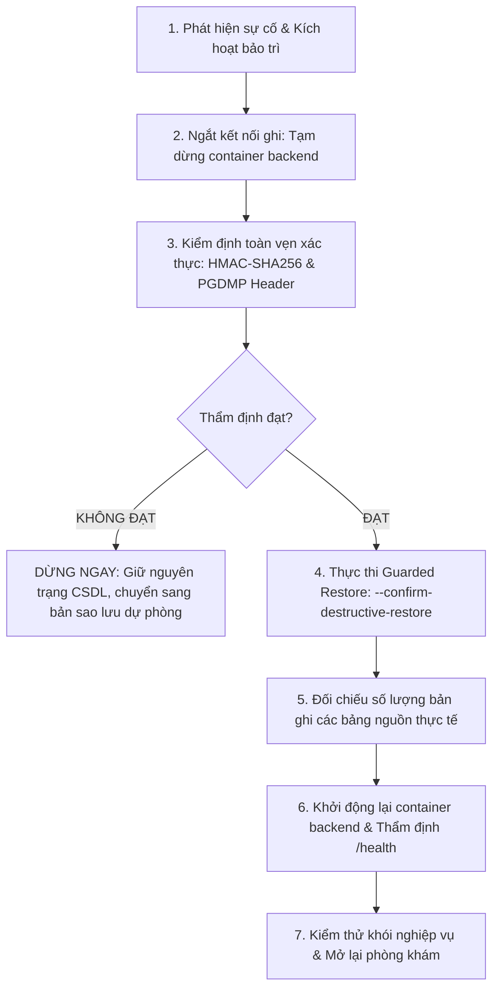

# SỔ TAY QUY TRÌNH KHÔI PHỤC THẢM HỌA CƠ SỞ DỮ LIỆU (DISASTER RECOVERY RUNBOOK)
## HỆ THỐNG PHÒNG KHÁM THÔNG MINH CLINIC-AI (MÃ DỰ ÁN: ACT-P1-09)

Tài liệu này đặc tả quy trình vận hành sao lưu, xác minh tính toàn vẹn xác thực (Authenticated Integrity) và khôi phục thảm họa cơ sở dữ liệu PostgreSQL cho hệ thống Clinic-AI, tuân thủ tiêu chuẩn an toàn dữ liệu y tế, bảo vệ thông tin sức khỏe (PHI) và các yêu cầu kỹ thuật trong kế hoạch sẵn sàng sản xuất.

---

## 1. MỤC TIÊU VÀ PHẠM VI (RPO & RTO)

| Chỉ số | Mục tiêu cam kết | Ý nghĩa thực tiễn |
| :--- | :--- | :--- |
| **RPO (Recovery Point Objective)** | **<= 24 giờ** (Bản sao lưu đầy đủ hàng ngày) / **<= 15 phút** (Khi kết hợp WAL Archiving) | Dữ liệu phòng khám bị mất trong tình huống thảm họa xấu nhất không vượt quá chu kỳ sao lưu gần nhất. |
| **RTO (Recovery Time Objective)** | **< 30 phút** | Tổng thời gian phát hiện, xác minh tệp sao lưu, giải mã qua đường ống và khôi phục hoàn chỉnh cơ sở dữ liệu để đưa dịch vụ trở lại phục vụ bệnh nhân. |
| **Mã hóa lưu trữ (Encryption at Rest)** | **AES-256-CBC + PBKDF2 (100,000 iterations)** | Toàn bộ tệp sao lưu ngoại vi được mã hóa an toàn, ngăn chặn rò rỉ thông tin sức khỏe (PHI) ngay cả khi tệp sao lưu bị thất lạc. |
| **Toàn vẹn xác thực (Authenticated Integrity)** | **HMAC-SHA256 (Keyed MAC) + SHA-256 Digest** | Mọi bản sao lưu phải được xác thực bằng mã xác thực thông điệp có khóa bí mật (HMAC-SHA256) nhằm ngăn chặn giả mạo bản mã (ciphertext tampering), padding oracle attacks và thay thế tệp trái phép. |
| **Bảo vệ quyền truy cập (Access & Permissions)** | **umask 077 + chmod 700/600 (Fail-Closed)** | Khởi tạo với `umask 077`, phân quyền nghiêm ngặt chỉ chủ sở hữu được truy cập (`drwx------` cho thư mục, `-rw-------` cho tệp). Tự động dừng khẩn cấp (fail-closed) nếu hệ thống tệp không thể bảo vệ quyền hạn. |

---

## 2. TIỀN ĐIỀU KIỆN VẬN HÀNH (OPERATIONAL PREREQUISITES)

### 2.1. Hạ tầng phần mềm & Tiện ích bắt buộc
* **Hệ quản trị CSDL:** PostgreSQL 15+ (hình ảnh container chuẩn `postgres:15-alpine`).
* **Công cụ sao lưu & khôi phục:** `pg_dump` và `pg_restore` (phiên bản tương thích với PostgreSQL 15).
* **Công cụ mã hóa & xác thực toàn vẹn:** OpenSSL 1.1.1 hoặc 3.x (`openssl version`) hỗ trợ PBKDF2; Python 3 với thư viện chuẩn `hmac`, `hashlib` và `pathlib` tính HMAC-SHA256.
* **Tiện ích dòng lệnh POSIX:** `bash` (4.x+), `python3`, `gzip`, `awk`, `realpath` (hoặc `readlink -f`). Không cần cài thêm gói Python.
* **Docker Engine & Compose:** (Tùy chọn) khi thực thi sao lưu/khôi phục trực tiếp thông qua container `clinic_postgres`.

**Lưu ý nâng cấp:** Bản sao lưu tạo trước khi áp dụng khóa MAC dẫn xuất theo miền sẽ không vượt qua xác minh của phiên bản hiện tại. Xác minh và khôi phục các bản cũ bằng phiên bản script đã tạo chúng trước khi chuyển sang bản này; sau đó tạo bản sao lưu mới.

### 2.2. Quản lý Khóa bí mật (Secrets Management)
Khóa mã hóa được nạp qua **biến môi trường** hoặc **tệp bí mật được bảo vệ**, tuyệt đối không ghi cứng trong mã nguồn, không in ra màn hình console và không xuất hiện trong danh sách đối số tiến trình (`ps aux`):

1. **Cách 1: Biến môi trường (Khuyến nghị cho CI/CD & Docker Secrets)**
   ```bash
   export BACKUP_ENCRYPTION_KEY="<chuoi_ngau_nhien_toi_thieu_32_ky_tu_do_openssl_sinh>"
   ```
   *Yêu cầu an toàn:* Độ dài tối thiểu 16 ký tự (khuyến nghị 32-64 ký tự). Script sẽ từ chối hoạt động (fail-closed) nếu thiếu khóa hoặc khóa dưới 16 ký tự.

2. **Cách 2: Tệp bí mật có phân quyền nghiêm ngặt (Khuyến nghị cho Bare-metal / Virtual Machine)**
   ```bash
   # Tạo tệp chứa khóa bí mật
   openssl rand -hex 32 > /etc/clinic_ai/backup_encryption.key

   # Phân quyền nghiêm ngặt chỉ tài khoản quản trị đọc được (0600)
   chmod 600 /etc/clinic_ai/backup_encryption.key
   chown root:root /etc/clinic_ai/backup_encryption.key
   ```
   Nạp qua cờ `--secret-file /etc/clinic_ai/backup_encryption.key` hoặc biến `BACKUP_ENCRYPTION_KEY_FILE`.
   *Cơ chế tự vệ:* Script sẽ kiểm tra quyền của tệp khóa và từ chối hoạt động ngay lập tức nếu tệp có quyền đọc cho nhóm hoặc người dùng khác (group/other permissions != 00).

### 2.3. Cấu hình Thư mục Lưu trữ, Chuẩn hóa Đường dẫn & Quyền hạn
* Thư mục sao lưu mặc định: `/var/backups/clinic_ai` hoặc `./backups`.
* Toàn bộ tiến trình thực thi dưới `umask 077` để đảm bảo không có cửa sổ lộ lọt dữ liệu (zero race condition window).
* Phân quyền thư mục sao lưu: `chmod 700` (`drwx------`), phân quyền tệp sao lưu: `chmod 600` (`-rw-------`).
* **Cơ chế Fail-Closed:** Nếu hệ thống tệp bên dưới không hỗ trợ áp dụng quyền hạn bảo mật (ví dụ chia sẻ mạng không phân quyền hoặc ổ đĩa gắn kết không hỗ trợ POSIX permissions), script sẽ từ chối tạo tệp để bảo vệ an toàn dữ liệu y tế. (Trong môi trường phát triển cục bộ WSL không mount metadata, có thể truyền `--allow-insecure-permissions` hoặc `ALLOW_INSECURE_PERMISSIONS=1`).
* **Chuẩn hóa đường dẫn (Path Canonicalization):** Sử dụng `realpath -m` để phân giải triệt để các đường dẫn tương đối, ký tự duyệt thư mục (`..`) và liên kết tượng trưng (symlinks). Script từ chối hoạt động nếu đích sao lưu nằm tại hoặc bên dưới các vị trí hệ thống nguy hiểm:
  * `/` (Thư mục gốc hệ điều hành)
  * `/bin`, `/sbin`, `/usr`, `/lib`, `/lib64`, `/lib32` (Thư viện và chương trình nhị phân hệ thống)
  * `/etc` (Tệp cấu hình hệ thống)
  * `/dev`, `/proc`, `/sys` (Hệ thống tệp ảo của hạt nhân Linux)
  * `/boot` (Dữ liệu khởi động hệ thống)
  * `/root` (Thư mục gốc của quản trị viên)
  * `/run`, `/var/run`, `/var/log` (Thư mục chạy tạm và nhật ký hệ thống)
* Từ chối ghi đè tệp sao lưu đã tồn tại theo mặc định (chỉ ghi đè khi có cờ tường minh `--overwrite`).

---

## 3. QUY TRÌNH THỰC THI SAO LƯU AN TOÀN

Script sao lưu nằm tại: `backend/scripts/backup_database.sh`.

### 3.1. Các kịch bản sao lưu thực tế

#### Kịch bản 1: Sao lưu trực tiếp từ máy chủ phát triển hoặc VM
```bash
export BACKUP_ENCRYPTION_KEY="chuoi_khoa_bi_mat_chuan_an_toan_32_ky_tu_tro_len"
export POSTGRES_PASSWORD="clinic_password"

bash backend/scripts/backup_database.sh \
  --db-name clinic_db \
  --db-user clinic_user \
  --db-host localhost \
  --db-port 5432 \
  --target-dir /var/backups/clinic_ai \
  --format custom
```

#### Kịch bản 2: Sao lưu thông qua Docker Container đang chạy
Khi PostgreSQL đang vận hành bên trong container Docker (`clinic_postgres`):
```bash
export BACKUP_ENCRYPTION_KEY="chuoi_khoa_bi_mat_chuan_an_toan_32_ky_tu_tro_len"
export POSTGRES_PASSWORD="clinic_password"

bash backend/scripts/backup_database.sh \
  --docker-container clinic_postgres \
  --db-name clinic_db \
  --db-user clinic_user \
  --target-dir ./backups \
  --format custom
```

#### Kịch bản 3: Chạy mô phỏng kiểm tra trước (Dry-run Mode)
Không tạo tệp và không chạm vào CSDL, chỉ thẩm định cấu hình, tham số, quyền thư mục và đường dẫn:
```bash
export BACKUP_ENCRYPTION_KEY="chuoi_khoa_bi_mat_chuan_an_toan_32_ky_tu_tro_len"
bash backend/scripts/backup_database.sh --dry-run
```

### 3.2. Cấu trúc các tệp sinh ra sau khi sao lưu thành công
Mỗi phiên sao lưu tạo ra đúng 4 tệp đồng bộ với quyền `-rw-------` (0600):
1. `<db_name>_<timestamp>.dump.enc`: Tệp nén định dạng `pg_dump -Fc -Z 9` và mã hóa AES-256-CBC PBKDF2.
2. `<db_name>_<timestamp>.dump.enc.hmac`: Thẻ xác thực có khóa HMAC-SHA256 của bản mã (Authenticated Integrity Tag).
3. `<db_name>_<timestamp>.dump.enc.sha256`: Mã băm SHA-256 đối chiếu toàn vẹn truyền tải.
4. `<db_name>_<timestamp>.dump.enc.meta.json`: Siêu dữ liệu phiên sao lưu gồm định dạng, thuật toán, số byte, thời gian UTC, mã băm SHA-256 và thẻ HMAC-SHA256.

Ví dụ nội dung tệp `clinic_db_20261113_020000Z.dump.enc.meta.json`:
```json
{
  "database": "clinic_db",
  "created_at_utc": "20261113_020000Z",
  "format": "custom",
  "compression_level": 9,
  "cipher": "aes-256-cbc",
  "pbkdf2_iterations": 100000,
  "file_size_bytes": 1428570,
  "sha256": "8d3e2365287f7396c21e6beae9582d1c970e7048a04fa77adadab74d1502f6ea",
  "hmac_sha256": "3fa9bc8723de4f1289c091adfe34bc567891234567890abcdef1234567890abc",
  "authenticated_integrity": "HMAC-SHA256",
  "version": "2.0.0"
}
```

### 3.3. Tự động hóa qua Linux Cron Job
Thiết lập crontab cho tài khoản vận hành (`crontab -e`):
```bash
# Thực hiện sao lưu CSDL phòng khám mỗi ngày lúc 02:00 sáng
0 2 * * * export BACKUP_ENCRYPTION_KEY_FILE=/etc/clinic_ai/backup_key.txt && /app/backend/scripts/backup_database.sh --target-dir /var/backups/clinic_ai >> /var/log/clinic_backup.log 2>&1
```

---

## 4. QUY TRÌNH KIỂM ĐỊNH & XÁC MINH TÍNH TOÀN VẸN XÁC THỰC (AUTHENTICATED INTEGRITY VERIFICATION)

### 4.1. Bộ tự kiểm tra độc lập cách ly (Isolated Safe Self-Check Suite)
Script tích hợp sẵn bộ kiểm thử an toàn gồm 17 bài kiểm tra độc lập trên thư mục tạm thời cách ly, hoàn toàn không chạm vào bất kỳ cơ sở dữ liệu thật hay khóa bí mật thực tế nào:
```bash
bash backend/scripts/backup_database.sh --self-check
```
*Danh mục 17 ca kiểm thử:*
1. Fail-closed khi thiếu khóa bí mật mã hóa.
2. Fail-closed khi khóa bí mật ngắn hơn 16 ký tự.
3. Nạp an toàn khóa bí mật từ tệp được phân quyền.
4. Fail-closed khi tệp khóa bí mật có phân quyền quá mở (nhóm/người khác có quyền đọc).
5. Từ chối các thư mục hệ thống nguy hiểm (`/`, `/etc`, `/usr`, `/bin`, `/var/run`, `/proc`, `/sys`, `/boot`, `/root`).
6. Kiểm tra an toàn chuẩn hóa đường dẫn và duyệt thư mục tương đối (`..`).
7. Từ chối tệp đích chỉ định nằm trong thư mục hệ thống.
8. Chống ghi đè tệp sao lưu đã tồn tại khi thiếu cờ `--overwrite`.
9. Kiểm soát phân quyền nghiêm ngặt theo `umask 077` (700 cho thư mục, 600 cho tệp).
10. Fail-closed khi hệ thống tệp để lộ quyền đọc cho nhóm hoặc người dùng khác.
11. Vòng đời toàn vẹn: nén, mã hóa, SHA-256 và HMAC-SHA256 khớp tuyệt đối với dữ liệu gốc.
12. Tính HMAC nhất quán trên tệp tổng hợp 3 MiB bằng các lượt đọc 1 MiB.
13. Phát hiện can thiệp phá hoại bản mã thông qua kiểm tra xác thực HMAC-SHA256.
14. Phát hiện sai lệch thẻ HMAC trong tệp siêu dữ liệu `.meta.json`.
15. Từ chối giải mã và xác thực khi sử dụng sai mật khẩu.
16. Từ chối thực thi khôi phục thảm họa có tính phá hủy khi thiếu cờ xác nhận tường minh.
17. Hủy bỏ khôi phục ngay lập tức trước khi chạm vào CSDL khi bản sao lưu không vượt qua xác minh toàn vẹn.
18. Kiểm tra chế độ chạy mô phỏng (dry-run) cho cả sao lưu và khôi phục không làm thay đổi trạng thái đĩa.

*Kết quả kỳ vọng:* Toàn bộ 18/18 ca kiểm thử đạt `PASS` với mã thoát `exit 0`.

### 4.2. Kiểm định tính toàn vẹn xác thực của bản sao lưu trước khi sử dụng
Trước khi lưu kho hoặc khôi phục, bắt buộc phải thẩm định tệp sao lưu:
```bash
export BACKUP_ENCRYPTION_KEY="chuoi_khoa_bi_mat_chuan_an_toan_32_ky_tu_tro_len"

bash backend/scripts/backup_database.sh --verify ./backups/clinic_db_20261113_020000Z.dump.enc
```
Quá trình kiểm định tự động thực thi 4 tầng bảo vệ:
1. **Kiểm tra thẻ HMAC-SHA256 (Authenticated Integrity):** Bắt buộc có sidecar `.hmac` không rỗng, chứa thẻ SHA-256 dạng hex 64 ký tự; thẻ được đối chiếu trước mọi giải mã. HMAC dùng khóa MAC dẫn xuất riêng theo miền từ passphrase và passphrase đi vào bộ tính qua stdin, không nằm trong argv hay environment của Python.
2. **Kiểm tra mã băm SHA-256:** Đối chiếu mã băm với tệp `.sha256` để loại trừ lỗi đường truyền.
3. **Kiểm tra siêu dữ liệu `.meta.json`:** Đối chiếu tính nhất quán giữa bản mã và thông tin mô tả trong manifest.
4. **Kiểm tra giải mã luồng & Chữ ký định dạng:** Giải mã thử nghiệm trong bộ nhớ (không ghi đĩa) và xác thực chữ ký nhị phân `PGDMP` (PostgreSQL Custom Format) hoặc gzip header `1f8b`.

---

## 5. QUY TRÌNH KHÔI PHỤC THẢM HỌA (DISASTER RECOVERY PROCEDURE)

> [!WARNING]
> **CẢNH BÁO NGUY HIỂM VỀ KHÔI PHỤC CÓ TÍNH PHÁ HỦY (DESTRUCTIVE RESTORE RISK):**
> Thao tác `pg_restore --clean` hoặc `dropdb` là thao tác có tính phá hủy dữ liệu hiện tại. Nếu chạy đường ống thô (`openssl | pg_restore --clean`) mà không xác minh trước tính toàn vẹn, trong tình huống tệp sao lưu bị lỗi hoặc khóa sai, `pg_restore` sẽ **XÓA CÁC BẢNG HIỆN TẠI** trước khi phát hiện tệp bị lỗi giải mã, dẫn đến mất trắng toàn bộ dữ liệu đang có!
> **NGUYÊN TẮC BẮT BUỘC:** Luôn sử dụng cơ chế khôi phục có bảo vệ (Guarded Restore) qua script `backup_database.sh --restore` với cờ `--confirm-destructive-restore <tên_csdl>` để đảm bảo tệp sao lưu đã được kiểm tra tính toàn vẹn xác thực 100% trước khi chạm vào cơ sở dữ liệu.



---

### 5.1. Kịch bản A: Diễn tập khôi phục trên CSDL kiểm thử độc lập (Sandbox Database)
Quy trình này áp dụng cho các đợt diễn tập định kỳ mà **tuyệt đối không chạm vào cơ sở dữ liệu đang vận hành**.

#### Bước 1: Tạo cơ sở dữ liệu kiểm thử rỗng
```bash
export PGPASSWORD="clinic_password"
createdb -h localhost -p 5432 -U clinic_user clinic_restore_test
```
*(Nếu dùng Docker: `docker exec -e PGPASSWORD=clinic_password clinic_postgres createdb -U clinic_user clinic_restore_test`)*

#### Bước 2: Thực thi khôi phục có bảo vệ (Guarded Restore)
```bash
export BACKUP_ENCRYPTION_KEY="chuoi_khoa_bi_mat_chuan_an_toan_32_ky_tu_tro_len"
export POSTGRES_PASSWORD="clinic_password"

bash backend/scripts/backup_database.sh \
  --restore ./backups/clinic_db_20261113_020000Z.dump.enc \
  --db-name clinic_restore_test \
  --confirm-destructive-restore clinic_restore_test
```

#### Bước 3: Đối chiếu số lượng bản ghi & Lược đồ Alembic (Bảng nguồn đã kiểm chứng)
Thực hiện truy vấn đối chiếu các bảng lõi theo đúng mô hình 3NF sản xuất (`backend/app/models/production_models.py` và Alembic Revision `018`):
```bash
psql -h localhost -p 5432 -U clinic_user -d clinic_restore_test -c "
  SELECT version_num FROM alembic_version;
  SELECT count(*) AS total_users FROM users;
  SELECT count(*) AS total_patients FROM patients;
  SELECT count(*) AS total_appointments FROM appointments;
  SELECT count(*) AS total_encounters FROM encounters;
  SELECT count(*) AS total_prescriptions FROM prescriptions;
  SELECT count(*) AS total_invoices FROM invoices;
  SELECT count(*) AS total_drugs FROM drugs;
  SELECT count(*) AS total_phi_audit_logs FROM phi_audit_logs;
"
```
*(Lưu ý đối chiếu mô hình kế thừa nếu môi trường còn duy trì bảng tiếng Việt: `tai_khoan`, `benh_nhan`, `lich_kham` [lưu ý tên bảng là `lich_kham`, không phải `cuoc_hen`], `don_thuoc`, `luot_kham`, `hoa_don`).*

#### Bước 4: Dọn dẹp CSDL kiểm thử sau khi nghiệm thu
```bash
dropdb -h localhost -p 5432 -U clinic_user clinic_restore_test
```

---

### 5.2. Kịch bản B: Khôi phục CSDL Production sau sự cố thảm họa (Production DR)
Áp dụng khi máy chủ CSDL chính gặp thảm họa (hỏng phần cứng, mã độc ransomware, mất dữ liệu nghiêm trọng).

#### Bước 1: Công bố tình trạng khẩn cấp và kích hoạt chế độ bảo trì
Thông báo cho các phòng khám, tiếp đón và nhà thuốc chuyển sang chế độ tiếp nhận phiếu giấy tạm thời.

#### Bước 2: Ngắt toàn bộ dịch vụ backend để chặn giao dịch ghi
```bash
docker compose stop backend
```

#### Bước 3: Kiểm định tính toàn vẹn xác thực của bản sao lưu
```bash
export BACKUP_ENCRYPTION_KEY="<khoa_bi_mat_chinh_thuc>"
bash backend/scripts/backup_database.sh --verify /path/to/production_backup.dump.enc
```
Chỉ tiến hành bước kế tiếp khi terminal in thông báo xác nhận:
`[INFO] Authenticated integrity and decryption verification PASSED`

#### Bước 4: Tạo bản sao lưu an toàn cho dữ liệu hiện trạng (Pre-Restore Safety Snapshot)
Trước khi thực hiện bất kỳ hành động phá hủy nào, sao lưu lại toàn bộ hiện trạng cơ sở dữ liệu hiện hữu (ngay cả khi nghi ngờ bị lỗi):
```bash
bash backend/scripts/backup_database.sh \
  --db-name clinic_db \
  --target-dir /var/backups/clinic_ai/pre_restore_snapshots \
  --format custom
```

#### Bước 5: Thực thi khôi phục có bảo vệ (Guarded Restore)
Thực thi lệnh khôi phục thông qua script có xác nhận tên CSDL tường minh:
```bash
export BACKUP_ENCRYPTION_KEY="<khoa_bi_mat_chinh_thuc>"
export POSTGRES_PASSWORD="<prod_postgres_password>"

bash backend/scripts/backup_database.sh \
  --restore /path/to/production_backup.dump.enc \
  --db-name clinic_db \
  --confirm-destructive-restore clinic_db
```

#### Bước 6: Thẩm tra dữ liệu các bảng nguồn và tính toàn vẹn y tế
Truy vấn kiểm tra toàn bộ 21 bảng sản xuất trong mã nguồn:
```bash
psql -h localhost -p 5432 -U clinic_user -d clinic_db -c "
  SELECT version_num FROM alembic_version;
  SELECT 'users' AS table_name, count(*) FROM users
  UNION ALL SELECT 'patients', count(*) FROM patients
  UNION ALL SELECT 'patient_allergies', count(*) FROM patient_allergies
  UNION ALL SELECT 'doctor_slots', count(*) FROM doctor_slots
  UNION ALL SELECT 'appointments', count(*) FROM appointments
  UNION ALL SELECT 'encounters', count(*) FROM encounters
  UNION ALL SELECT 'clinical_vitals', count(*) FROM clinical_vitals
  UNION ALL SELECT 'diagnoses_icd10', count(*) FROM diagnoses_icd10
  UNION ALL SELECT 'encounter_diagnoses', count(*) FROM encounter_diagnoses
  UNION ALL SELECT 'services', count(*) FROM services
  UNION ALL SELECT 'paraclinical_orders', count(*) FROM paraclinical_orders
  UNION ALL SELECT 'paraclinical_results', count(*) FROM paraclinical_results
  UNION ALL SELECT 'drugs', count(*) FROM drugs
  UNION ALL SELECT 'drug_batches', count(*) FROM drug_batches
  UNION ALL SELECT 'prescriptions', count(*) FROM prescriptions
  UNION ALL SELECT 'prescription_items', count(*) FROM prescription_items
  UNION ALL SELECT 'invoices', count(*) FROM invoices
  UNION ALL SELECT 'invoice_items', count(*) FROM invoice_items
  UNION ALL SELECT 'payment_transactions', count(*) FROM payment_transactions
  UNION ALL SELECT 'emr_signed_records', count(*) FROM emr_signed_records
  UNION ALL SELECT 'phi_audit_logs', count(*) FROM phi_audit_logs;
"
```
Đảm bảo bảng `alembic_version` khớp với revision `018` và các bản ghi không bị khuyết thiếu.

#### Bước 7: Khởi động lại dịch vụ backend và kiểm tra trạng thái sức khỏe
```bash
docker compose up -d backend
```
Kiểm tra endpoint giám sát sức khỏe:
```bash
curl -f http://localhost:8000/health
```
Phản hồi hợp lệ: `{"status":"healthy","database":"connected",...}`.

#### Bước 8: Kiểm thử khói (Smoke Test) và giải phóng bảo trì
Thực hiện đăng nhập thử nghiệm tài khoản quản trị và bác sĩ trên giao diện người dùng, xác nhận thông tin lịch khám và hồ sơ bệnh án hiển thị đầy đủ, sau đó gỡ bỏ chế độ bảo trì để phòng khám hoạt động trở lại.

---

## 6. DANH MỤC CÁC BẢNG DỮ LIỆU ĐÃ KIỂM CHỨNG TỪ MÃ NGUỒN (VERIFIED SOURCE TABLES)

Đối chiếu trực tiếp từ `backend/app/models/production_models.py` và `backend/alembic/versions/018_production_3nf_schema_and_clean_bff.py`:

| STT | Tên bảng sản xuất (3NF) | Phân hệ nghiệp vụ | Mô tả chức năng | Tên bảng kế thừa (Legacy nếu có) |
| :--- | :--- | :--- | :--- | :--- |
| 1 | `users` | Quản trị & Xác thực | Tài khoản nhân viên, bác sĩ, điều dưỡng, thu ngân | `tai_khoan`, `nguoi_dung` |
| 2 | `patients` | Quản lý Bệnh nhân | Hồ sơ bệnh nhân, mã định danh, CCCD, liên hệ | `benh_nhan` |
| 3 | `patient_allergies` | Lâm sàng & Dị ứng | Dị ứng thuốc, thực phẩm, mức độ nghiêm trọng | - |
| 4 | `doctor_slots` | Lịch trình Bác sĩ | Khung giờ làm việc và tiếp nhận khám của bác sĩ | `lich_lam_viec` |
| 5 | `appointments` | Lịch hẹn khám | Lịch hẹn bệnh nhân đặt trước và tiếp nhận | `lich_kham` *(không phải `cuoc_hen`)* |
| 6 | `encounters` | Khám chữa bệnh | Lượt khám bệnh ngoại trú, phòng khám, trạng thái | `luot_kham` |
| 7 | `clinical_vitals` | Sinh hiệu lâm sàng | Huyết áp, mạch, nhiệt độ, nhịp thở, SpO2, BMI | `luot_kham_the_luc` |
| 8 | `diagnoses_icd10` | Danh mục Bệnh học | Danh mục mã bệnh tiêu chuẩn quốc tế ICD-10 | `danh_muc_icd10` |
| 9 | `encounter_diagnoses` | Chẩn đoán lượt khám | Chẩn đoán xác định, chẩn đoán sơ bộ theo ca khám | `chan_doan` |
| 10 | `services` | Danh mục Dịch vụ | Bảng giá và dịch vụ khám, xét nghiệm, chẩn đoán hình ảnh | `dich_vu` |
| 11 | `paraclinical_orders` | Chỉ định Cận lâm sàng | Phiếu chỉ định xét nghiệm, chụp X-quang, siêu âm | `chi_dinh` |
| 12 | `paraclinical_results` | Kết quả Cận lâm sàng | Thông số xét nghiệm, kết luận, giá trị báo động | `ket_qua_cls`, `chi_tiet_ket_qua_cls` |
| 13 | `drugs` | Dược & Thuốc | Danh mục thuốc, biệt dược, hoạt chất, đường dùng | `thuoc` |
| 14 | `drug_batches` | Kho dược & Lô thuốc | Quản lý hạn dùng theo lô FEFO và tồn kho vật lý | - |
| 15 | `prescriptions` | Đơn thuốc Bác sĩ | Đơn thuốc điện tử, mã đơn quốc gia, trạng thái cổng Dược | `don_thuoc` |
| 16 | `prescription_items` | Chi tiết Đơn thuốc | Liều dùng sáng/trưa/chiều/tối, số lượng, hướng dẫn | `chi_tiet_don_thuoc` |
| 17 | `invoices` | Thu ngân & Viện phí | Hóa đơn dịch vụ và thuốc, tổng tiền, miễn giảm | `hoa_don` |
| 18 | `invoice_items` | Chi tiết Hóa đơn | Khoản mục thanh toán dịch vụ hoặc tiền thuốc | `chi_tiet_hoa_don` |
| 19 | `payment_transactions` | Giao dịch Thanh toán | Giao dịch cổng thanh toán VietQR, thẻ POS, đối soát | `giao_dich_thanh_toan` |
| 20 | `emr_signed_records` | Bệnh án Điện tử | Chữ ký số EMR, hash tài liệu y tế, chứng thư số | `bien_ban_dinh_chinh` |
| 21 | `phi_audit_logs` | Nhật ký Kiểm toán PHI | Kiểm toán truy cập dữ liệu y tế nhạy cảm theo HIPAA/Nghị định 13 | `nhat_ky_truy_cap_y_te` |

---

## 7. SỔ TAY XỬ LÝ SỰ CỐ VẬN HÀNH (TROUBLESHOOTING PLAYBOOK)

| Hiện tượng lỗi | Nguyên nhân gốc rễ | Biện pháp xử lý ngay |
| :--- | :--- | :--- |
| `Authenticated integrity failure: HMAC-SHA256 mismatch` | Tệp sao lưu bị thay đổi bản mã (can thiệp hoặc hỏng hóc), hoặc khóa bí mật `BACKUP_ENCRYPTION_KEY` không đúng. | 1. Kiểm tra lại chuỗi khóa trong kho quản lý mật mã (Vault).<br>2. Tuyệt đối không phục hồi từ tệp bị lỗi; chuyển sang bản sao lưu dự phòng kế tiếp. |
| `Permission protection failed: mode is ... Failing closed` | Thư mục hoặc tệp đích nằm trên hệ thống tệp không thể khóa quyền hạn (vẫn có quyền đọc cho group/other). | 1. Đảm bảo đích sao lưu nằm trên phân vùng ext4/xfs chuẩn của máy chủ.<br>2. Chạy `chmod 700 <dir>`.<br>3. Nếu chạy thử nghiệm trên máy dev WSL, sử dụng `--allow-insecure-permissions`. |
| `Unsafe target directory '...' Operation rejected` | Thư mục đích rơi vào các thư mục hệ thống nguy hiểm (`/`, `/etc`, `/usr`, `/bin`, `/var/run`, `/proc`,...). | Chỉ định thư mục lưu trữ an toàn như `/var/backups/clinic_ai` hoặc thư mục dự án cục bộ `./backups`. |
| `DESTRUCTIVE RESTORE REFUSED: ... To authorize execution, you MUST explicitly provide: --confirm-destructive-restore <name>` | Cơ chế an toàn kích hoạt nhằm ngăn chặn vô tình xóa sạch CSDL production. | Bổ sung cờ `--confirm-destructive-restore <tên_csdl>` khớp chính xác với `--db-name`. |
| `Target file already exists. Overwrite refused` | Tệp trùng tên đã tồn tại trong thư mục đích. | Chỉ định tên tệp mới bằng `--output-file`, hoặc thêm cờ `--overwrite` nếu chủ đích muốn ghi đè. |
| `relation "cuoc_hen" does not exist` | Tên bảng trong truy vấn cũ không khớp với mã nguồn backend. | Sử dụng bảng `appointments` (cho mô hình 3NF chuẩn) hoặc `lich_kham` (cho mô hình kế thừa). |

---

## 8. KẾ HOẠCH DIỄN TẬP ĐỊNH KỲ (DISASTER RECOVERY DRILL PLAN)

1. **Chu kỳ diễn tập:** 3 tháng một lần (Quarterly DR Drill).
2. **Hình thức diễn tập:** Khôi phục bản sao lưu ngẫu nhiên vào CSDL Sandbox độc lập (`clinic_restore_test`) bằng lệnh `--restore` có bảo vệ.
3. **Tiêu chuẩn nghiệm thu biên bản diễn tập:**
   - [ ] Tệp sao lưu được chọn ngẫu nhiên vượt qua kiểm định tính toàn vẹn xác thực `--verify` 100% (HMAC-SHA256, SHA-256, PGDMP Header).
   - [ ] Thời gian giải mã và khôi phục hoàn tất dưới 30 phút (đạt RTO).
   - [ ] Toàn bộ 21 bảng CSDL theo mô hình 3NF sản xuất có dữ liệu toàn vẹn.
   - [ ] Bảng `alembic_version` trùng khớp chính xác revision hiện hành (`018`).
   - [ ] Biên bản diễn tập được ký xác nhận bởi Trưởng nhóm kỹ thuật và Quản trị viên hệ thống.
