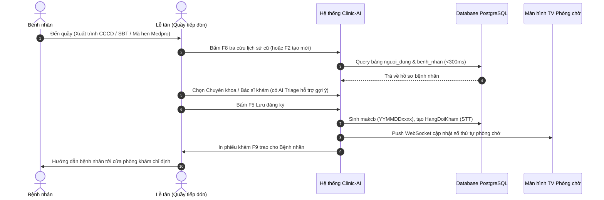
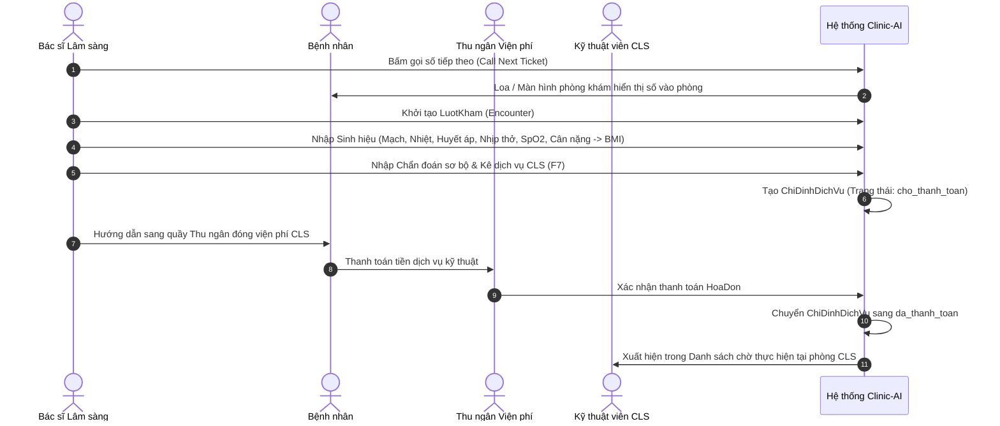
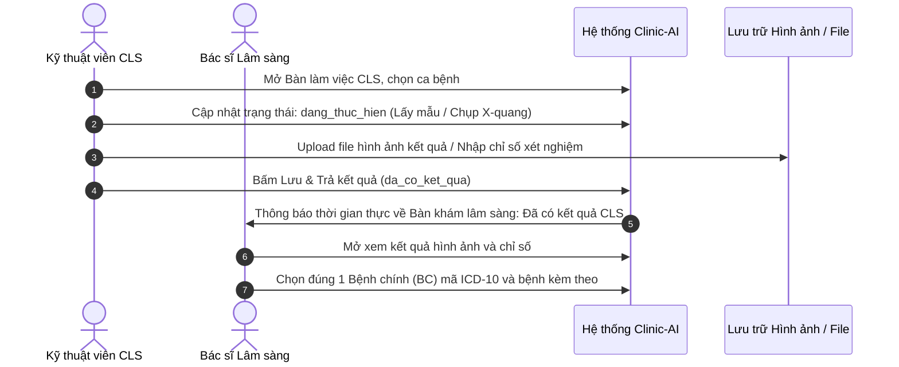
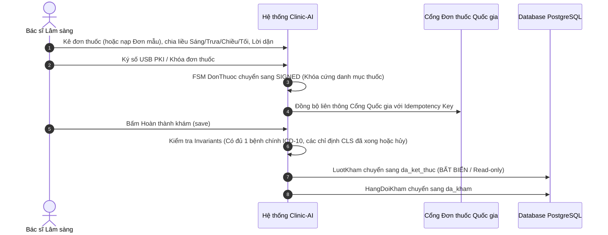
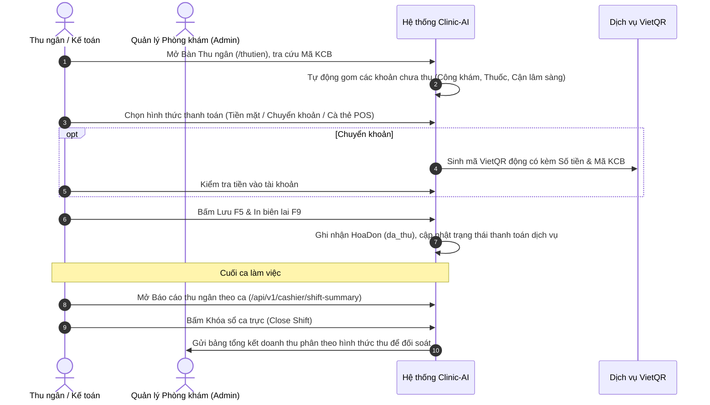

# QUY TRÌNH NGHIỆP VỤ THỰC TẾ TCLINIC (WORKFLOWS SPECIFICATION)
## CÁC LUỒNG TÁC NGHIỆP ĐIỀU HÀNH PHÒNG KHÁM NGOẠI TRÚ

**Thời điểm lập:** 12/10/2026  
**Tài liệu:** `docs/analysis/TCLINIC_WORKFLOWS.md`  

---

## 1. Luồng 1: Tiếp đón & Điều phối Hàng đợi (Reception & Queueing)

- **Quy tắc bất biến:**
  - `makcb` sinh tự động theo mẫu `YYMMDD` + 4 số tăng dần trong ngày.
  - Cờ `uutien` (người già >75t, phụ nữ mang thai, trẻ em <6t) được ưu tiên xếp vào nhóm gọi số trước.

---

## 2. Luồng 2: Khám lâm sàng & Chỉ định Cận lâm sàng (Clinical & Subclinical Order)

---

## 3. Luồng 3: Thực hiện CLS & Trả kết quả (Subclinical Execution & Result Return)

---

## 4. Luồng 4: Kê đơn thuốc, Ký số & Khóa hồ sơ Bệnh án EMR (Prescription & Locking)

---

## 5. Luồng 5: Thu ngân Viện phí & Khóa sổ Ca trực (Cashier Billing & Shift Closing)

