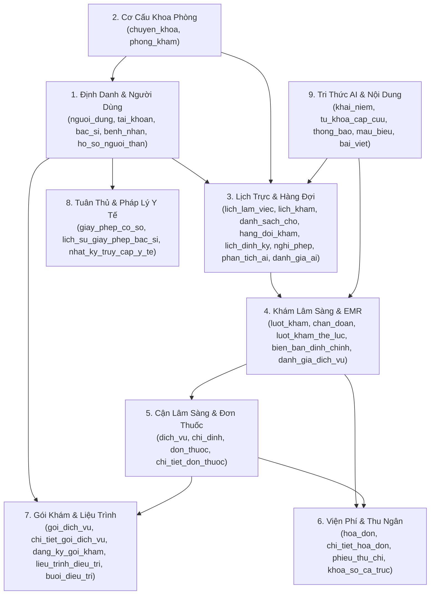
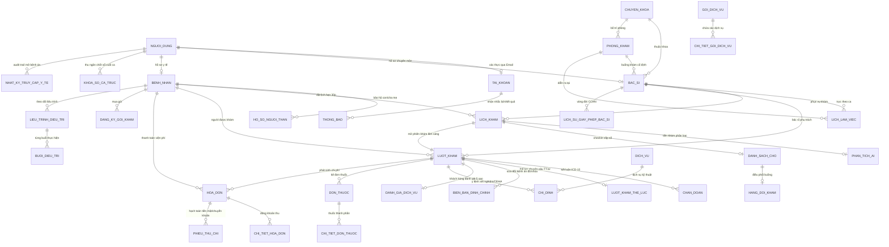

# SƠ ĐỒ THIẾT KẾ CƠ SỞ DỮ LIỆU TOÀN DIỆN (ENTERPRISE ERD SPECIFICATION)
## DỰ ÁN HỆ THỐNG QUẢN LÝ PHÒNG KHÁM THÔNG MINH CLINIC-AI (42 BẢNG)

**Phiên bản:** 2.1 (Tinh gọn 42 Bảng - Trục Khám Lâm Sàng Cốt Lõi)  
**Tương thích:** PostgreSQL 16+ / SQLite 3  
**Chuẩn thiết kế:** OpenMRS Encounter / FHIR R4 / Thông tư 32/2023/TT-BYT & Quyết định 130/QĐ-BYT  

---

## 1. SƠ ĐỒ TỔNG THỂ CÁC PHÂN VÙNG DỮ LIỆU (ENTERPRISE DOMAIN MAP)

---

## 2. SƠ ĐỒ THỰC THỂ QUAN HỆ CỐT LÕI (CORE RELATIONSHIP ERD)

---

## 3. CHI TIẾT 9 PHÂN HỆ VÀ 42 BẢNG CSDL

### PHÂN HỆ 1: NGƯỜI DÙNG & ĐỊNH DANH TÀI KHOẢN (5 BẢNG)
1. **`nguoi_dung`**: Bảng gốc lưu thông tin cá nhân (Họ tên, SĐT, Ngày sinh, Giới tính, Địa chỉ, Số CCCD).
2. **`tai_khoan`**: Bảng xác thực đăng nhập duy nhất bằng **Email**, băm mật khẩu BCrypt, JWT Refresh Token, vai trò (`ADMIN`, `DOCTOR`, `RECEPTIONIST`, `PATIENT`).
3. **`bac_si`**: Bảng hồ sơ chuyên môn (Số CCHN, Học vị BSCKI/ThS/PGS, Giá khám mặc định, Buồng khám vật lý).
4. **`benh_nhan`**: Bảng hồ sơ bệnh nhân (Mã y tế `BN-YYYY-XXXX`, Nhóm máu, Tiền sử bệnh lý, Dị ứng, Thông tin thân nhân & SĐT người liên hệ khẩn cấp).
5. **`ho_so_nguoi_than`**: Quản lý người phụ thuộc (con nhỏ, cha mẹ già) do bệnh nhân đăng ký để đặt lịch hộ.

---

### PHÂN HỆ 2: CƠ CẤU TỔ CHỨC & PHÒNG KHÁM (2 BẢNG)
6. **`chuyen_khoa`**: Danh mục chuyên khoa lâm sàng (Nội, Ngoại, Nhi, Tai Mũi Họng, Răng Hàm Mặt, Sản, Da Liễu).
7. **`phong_kham`**: Danh mục buồng khám vật lý (Phòng 101, Phòng 102, vị trí tầng, trạng thái hoạt động).

---

### PHÂN HỆ 3: LỊCH TRỰC, HÀNG ĐỢI & ĐẶT HẸN (8 BẢNG)
8. **`lich_lam_viec`**: Ca trực thực tế theo ngày của Bác sĩ tại buồng khám (Sáng / Chiều / Tối, giới hạn ca khám).
9. **`lich_kham`**: Lịch hẹn của bệnh nhân theo slot 30 phút (Mã lịch khám, Giờ khám, Lý do khám, Trạng thái).
10. **`danh_sach_cho`**: Bảng điều phối hàng đợi thông minh tại sảnh chờ (Phân loại: Đúng hẹn, Đến sớm, Đến muộn, Vãng lai, Trả KQ).
11. **`hang_doi_kham`**: Hàng đợi trước cửa từng phòng khám (Số thứ tự gọi vào, Tạm hoãn, Đang khám).
12. **`lich_dinh_ky_bac_si`**: Mẫu phân ca tuần định kỳ (Bahmni Weekly Roster Template).
13. **`nghi_phep_bac_si`**: Đơn xin nghỉ phép của bác sĩ và tự động điều phối bệnh nhân bị ảnh hưởng.
14. **`phan_tich_ai`**: Kết quả trợ lý AI Triage gợi ý chuyên khoa và câu hỏi sàng lọc trước khám.
15. **`danh_gia_ai`**: Đánh giá độ chuẩn xác thực tế của AI Triage từ bác sĩ chuyên khoa.

---

### PHÂN HỆ 4: KHÁM LÂM SÀNG & BỆNH ÁN ĐIỆN TỬ EMR (5 BẢNG)
16. **`luot_kham`**: Phiên khám lâm sàng (OpenMRS Encounter) - Lưu mã đợt khám chữa bệnh (`ma_kcb`), sinh hiệu chuẩn hóa (Mạch, Nhiệt độ, Huyết áp, SpO2, BMI), triệu chứng, chẩn đoán sơ bộ, tiền sử dị ứng, kết luận điều trị, lời dặn tái khám, khóa hồ sơ theo TT 32/2023.
17. **`chan_doan`**: Danh sách chẩn đoán mã bệnh ICD-10 (Chẩn đoán chính, Chẩn đoán phụ kèm theo).
18. **`luot_kham_the_luc`**: Chi tiết khám thể lực chuyên sâu theo Thông tư 32/2023 (Thị lực, TMH, RHM, Nội, Ngoại, Da liễu, Phân loại I - V).
19. **`bien_ban_dinh_chinh`**: Biên bản hội chẩn đính chính bệnh án sau khi đã khóa (Four-Eyes Principle).
20. **`danh_gia_dich_vu`**: Khảo sát hài lòng của người bệnh sau khi khám (1 - 5 sao bác sĩ, phòng khám, ý kiến đóng góp).

---

### PHÂN HỆ 5: CẬN LÂM SÀNG & KÊ ĐƠN THUỐC (4 BẢNG)
21. **`dich_vu`**: Danh mục dịch vụ kỹ thuật, khám bệnh, xét nghiệm máu, siêu âm, X-Quang, CT theo giá niêm yết.
22. **`chi_dinh`**: Phiếu chỉ định y lệnh cận lâm sàng (Mã y lệnh, Giảm giá, Thành tiền, Trạng thái: Chờ thanh toán -> Chờ thực hiện -> Đã có KQ).
23. **`don_thuoc`**: Đơn thuốc ngoại trú (Mã đơn, Số ngày dùng, Trạng thái FSM: DRAFT -> SUBMITTED -> DISPENSED, Bác sĩ kê).
24. **`chi_tiet_don_thuoc`**: Danh sách từng loại thuốc trong đơn (Tên thuốc, Hoạt chất, Số lượng, Đơn vị, Liều 4 cữ Sáng - Trưa - Chiều - Tối, Số ngày dùng, Cách dùng).

---

### PHÂN HỆ 6: THU NGÂN, VIỆN PHÍ & DÒNG TIỀN (4 BẢNG)
25. **`hoa_don`**: Hóa đơn viện phí tổng hợp cho bệnh nhân (Tổng tiền, Giảm giá, Bảo hiểm tư nhân, Thực thu, Trạng thái).
26. **`chi_tiet_hoa_don`**: Chi tiết các khoản thu viện phí trong hóa đơn (Từng dịch vụ khám, xét nghiệm, đơn thuốc).
27. **`phieu_thu_chi`**: Biên lai hạch toán thu tiền mặt, chuyển khoản VietQR, quẹt thẻ POS hoặc phiếu hoàn tiền.
28. **`khoa_so_ca_truc`**: Biên bản bàn giao ca trực thu ngân, chốt kiểm kê tiền mặt thực tế vs số liệu hệ thống.

---

### PHÂN HỆ 7: TUÂN THỦ PHÁP LÝ & GIẤY PHÉP Y TẾ (3 BẢNG)
29. **`giay_phep_co_so`**: Giấy phép hoạt động phòng khám, phạm vi chuyên môn và thời hạn cấp phép Sở Y Tế.
30. **`lich_su_giay_phep_bac_si`**: Quản lý vòng đời chứng chỉ hành nghề CCHN (Cấp mới, Gia hạn, Đình chỉ).
31. **`nhat_ky_truy_cap_y_te`**: Audit Log giám sát truy cập hồ sơ bệnh án (Ai xem bệnh án nào, thời gian nào, IP nào).

---

### PHÂN HỆ 8: GÓI DỊCH VỤ & LIỆU TRÌNH ĐIỀU TRỊ CÁ NHÂN (5 BẢNG)
32. **`goi_dich_vu`**: Danh mục gói khám sức khỏe tầm soát (Gói Khám tổng quát, Gói VIP, Gói Phụ nữ).
33. **`chi_tiet_goi_dich_vu`**: Danh sách các dịch vụ kỹ thuật thành phần cấu thành gói.
34. **`dang_ky_goi_kham`**: Đăng ký và theo dõi tiến độ sử dụng gói dịch vụ của người bệnh.
35. **`lieu_trinh_dieu_tri`**: Kế hoạch điều trị phục hồi chức năng, vật lý trị liệu nhiều buổi.
36. **`buoi_dieu_tri`**: Ghi nhận tiến triển, can thiệp chuyên môn từng buổi cụ thể.

---

### PHÂN HỆ 9: TRI THỨC Y KHOA AI, NỘI DUNG & THÔNG BÁO (6 BẢNG)
37. **`khai_niem`**: Từ điển khái niệm y khoa OpenMRS Concept (Triệu chứng, Mã bệnh, Chỉ số xét nghiệm).
38. **`tu_khoa_cap_cuu`**: Từ khóa dấu hiệu cảnh báo đỏ (Red Flags) lâm sàng kích hoạt cảnh báo nguy cấp.
39. **`thong_bao`**: Trung tâm thông báo người dùng (Nhắc lịch hẹn trước 24h, Gọi số thứ tự, Trả kết quả CLS).
40. **`mau_bieu_y_te`**: Mẫu in phiếu khám, phiếu chỉ định, giấy hẹn tái khám, đơn thuốc.
41. **`bai_viet_tin_tuc`**: Cổng tin tức y tế, khuyến cáo sức khỏe phòng khám.
42. **`he_thong_trang_thai_bff`**: Quản lý trạng thái và đồng bộ dữ liệu giao diện BFF (Backend-For-Frontend).

---

## 4. RÀNG BUỘC TOÀN VẸN CƠ SỞ DỮ LIỆU (DATABASE INVARIANTS)
1. **Khóa định danh**: Mọi tài khoản trong hệ thống đều định danh bằng `TaiKhoan.email` (`UNIQUE, NOT NULL`).
2. **Khóa chống sửa đổi bệnh án (Immutability)**: Khi `LuotKham.is_locked = TRUE`, cấm mọi hành vi cập nhật đè lên `chan_doan` hoặc `luot_kham`; mọi sửa đổi bắt buộc phải lập biên bản qua bảng `bien_ban_dinh_chinh`.
3. **Không quản lý kho dược**: Hệ thống không tính tồn kho theo lô/hạn, đơn thuốc chỉ lưu tên thuốc, hoạt chất và liều dùng ngoại trú.
4. **Audit Trail**: Mọi hành vi đăng nhập, truy cập bệnh án và duyệt đính chính đều lưu log có dấu thời gian UTC vào `nhat_ky_truy_cap_y_te`.
