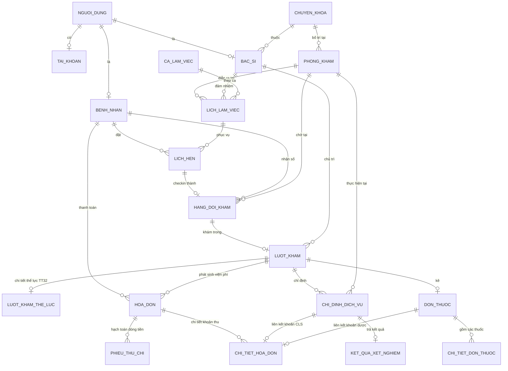

# THIẾT KẾ MÔ HÌNH DỮ LIỆU MỞ RỘNG (ERD SPECIFICATION)
## POSTGRESQL / OPENMRS SCHEMA CHO CLINIC-AI

**Thời điểm lập:** 12/10/2026  
**Tài liệu:** `docs/design/ERD.md`  

---

## 1. Sơ đồ Quan hệ Thực thể (Entity-Relationship Diagram)

---

## 2. Các Bảng Mở rộng Mới (New Extended Tables)

### 2.1. Bảng `hoa_don` (Patient Invoice & Billing)
- Lưu thông tin hóa đơn thanh toán viện phí tổng hợp của ca khám (công khám + CLS + thuốc).
- Trạng thái: `chua_thu`, `da_thu`, `da_huy`, `da_hoan_tien`.

### 2.2. Bảng `chi_tiet_hoa_don` (Invoice Line Items)
- Từng dòng khoản thu trong hóa đơn, liên kết dịch vụ kỹ thuật hoặc đơn thuốc, số lượng, đơn giá, giảm giá, thành tiền.

### 2.3. Bảng `phieu_thu_chi` (Receipts & Vouchers)
- Quản lý biên lai thu tiền mặt, chuyển khoản (VietQR), cà thẻ POS, hoặc phiếu hoàn tiền cho bệnh nhân khi hủy dịch vụ.

### 2.4. Bảng `luot_kham_the_luc` (Physical Exam & Specialist Findings - TT 32/2023)
- Lưu các chỉ số chuyên khoa sâu:
  - Thị lực mắt trái/phải, có kính/không kính.
  - Tai mũi họng (tai, mũi, họng, thanh quản).
  - Răng hàm mặt (hàm trên, hàm dưới, bệnh răng).
  - Nội khoa (tuần hoàn, hô hấp, tiêu hóa, thận tiết niệu, thần kinh, cơ xương khớp).
  - Ngoại khoa, Da liễu, Sản phụ khoa (nếu là nữ).
  - Xếp loại thể lực chung: `loai_1`, `loai_2`, `loai_3`, `loai_4`, `loai_5`.
  - Kết luận đủ sức khỏe công tác / học tập / lái xe.
