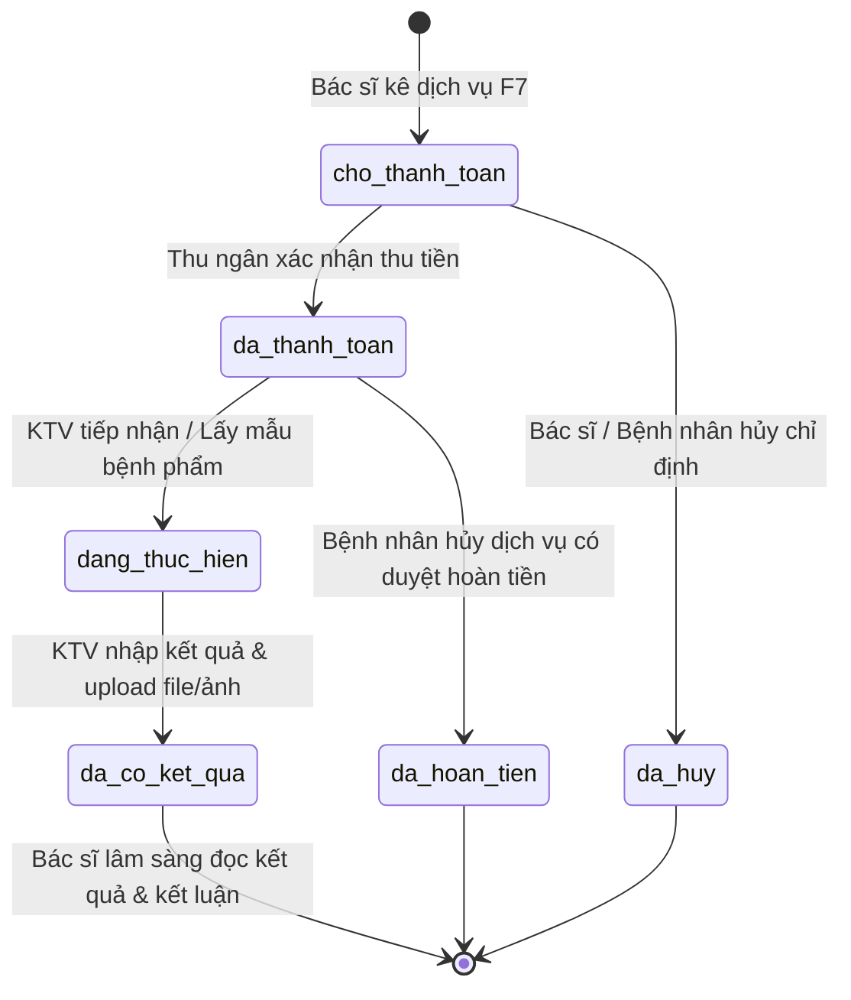
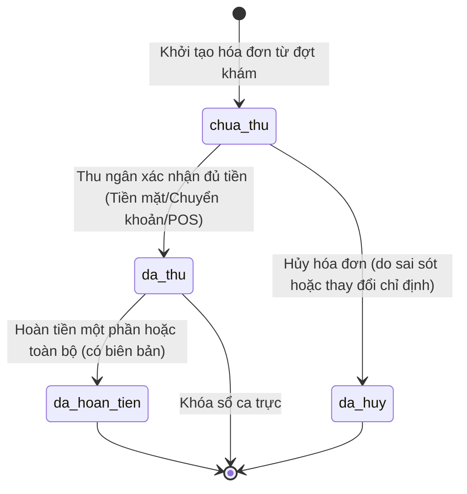
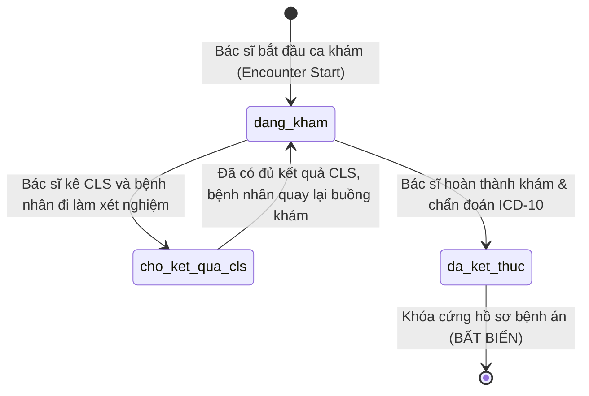

# THIẾT KẾ MÁY TRẠNG THÁI HỮU HẠN CỐT LÕI (STATE MACHINES SPECIFICATION)
## CÁC CHU TRÌNH SỐNG THỰC THỂ Y TẾ TRONG CLINIC-AI

**Thời điểm lập:** 12/10/2026  
**Tài liệu:** `docs/design/STATE_MACHINES.md`  

---

## 1. Máy Trạng thái Chỉ định Cận lâm sàng (`ChiDinhDichVu`)

### Quy tắc Chuyển trạng thái & Bất biến:
1. **Chặn thực hiện khi chưa thanh toán:** Kỹ thuật viên CLS chỉ được chuyển trạng thái sang `dang_thuc_hien` khi trạng thái hiện tại là `da_thanh_toan` (trừ trường hợp ca cấp cứu khẩn cấp được phê duyệt).
2. **Khóa kết quả sau khi trả:** Khi đã ở `da_co_ket_qua`, KTV không được tự ý xóa hoặc thay đổi kết quả. Mọi đính chính phải lưu vết lịch sử người sửa và lý do.
3. **Điều kiện kết thúc ca khám:** Nếu lượt khám có bất kỳ chỉ định nào đang ở `cho_thanh_toan`, `da_thanh_toan` hoặc `dang_thuc_hien`, Bác sĩ không thể bấm **Hoàn thành khám** (Hệ thống trả lỗi HTTP 422: *"Vui lòng đợi kết quả CLS hoặc hủy các chỉ định chưa thực hiện"*).

---

## 2. Máy Trạng thái Hóa đơn Viện phí (`HoaDon`)

### Quy tắc Bất biến:
1. **Toán học thanh toán:** `thuc_thu = tong_tien - mien_giam`. Tuyệt đối không cho phép `thuc_thu < 0`.
2. **Liên kết đồng bộ:** Khi `HoaDon` chuyển sang `da_thu`, tất cả các `ChiDinhDichVu` liên kết tự động chuyển trạng thái từ `cho_thanh_toan` sang `da_thanh_toan`.

---

## 3. Máy Trạng thái Lượt khám Lâm sàng (`LuotKham`)

### Ràng buộc Bất biến Cốt lõi:
1. `da_ket_thuc` là trạng thái **ĐÓNG BĂNG VĨNH VIỄN**. Mọi API ghi đè trực tiếp (`PUT /api/v1/clinical/encounters/:id`) đều bị chặn (HTTP 409 Conflict).
2. Sửa đổi sau khi đóng bắt buộc phải thông qua Biên bản đính chính `BienBanDinhChinh` theo nguyên tắc 4 mắt (Four-Eyes Principle) quy định tại Thông tư 13/2025/TT-BYT.
