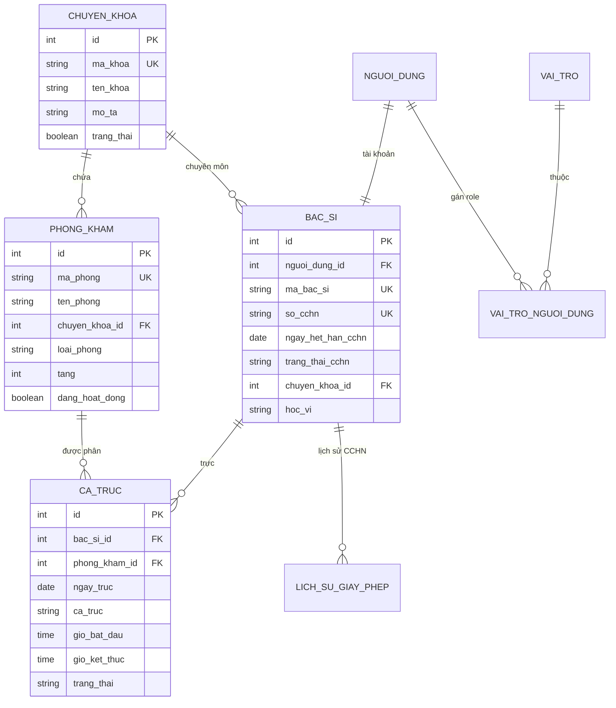
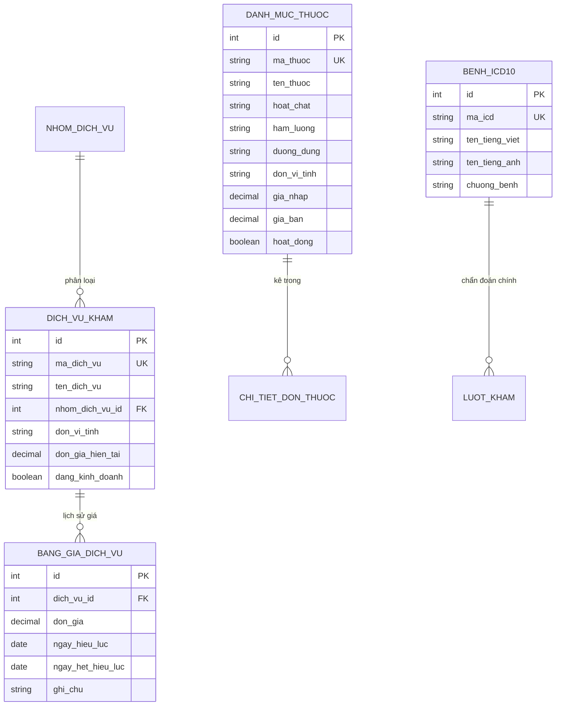
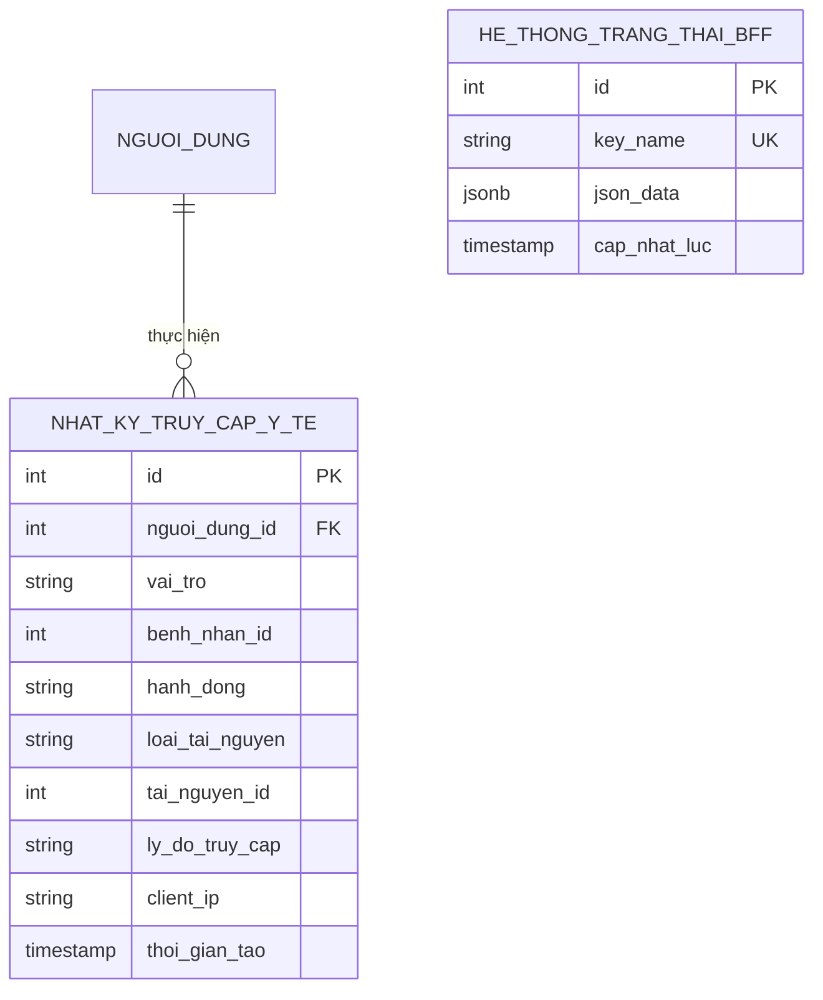

# Phase 1 Data Model: Phân hệ Quản trị viên (Admin Portal)

**Feature**: `001-admin-portal-tclinic` | **Date**: 2026-11-10

---

## 1. Domain Entities & Database Mapping

### 1.1 Cơ cấu Tổ chức & Nhân sự Y tế (Organization & Staff)

### 1.2 Danh mục Y tế & Bảng giá Dịch vụ (Catalog & Pricing)

### 1.3 Kiểm toán Dữ liệu Y tế & Cấu hình (Audit & Compliance)

---

## 2. Business Invariants & State Transitions

### 2.1 Trạng thái Chứng chỉ Hành nghề Bác sĩ (`trang_thai_cchn`)
- **Phân loại trạng thái**:
  - `ACTIVE` (Hiệu lực), `EXPIRED` (Hết hạn), `SUSPENDED` (Đình chỉ): Nguyên tắc nghiệp vụ đã phê duyệt theo US-03 AC-6 và FR-034; ranh giới pháp lý chi tiết đang chờ xác minh tại OQ-4 (Luật Khám bệnh, chữa bệnh 2023, TT 32/2023/TT-BYT).
  - `REVOKED` (Thu hồi): **Đề xuất kỹ thuật chưa phê duyệt (Unapproved Technical Proposal)**; không phải invariant hay kịch bản chấp nhận đã được PO duyệt; chờ PO và thẩm định pháp lý tại OQ-4 xem xét.
  - `EXPIRING_SOON` (Sắp hết hạn trong ≤30 ngày): **Đề xuất kỹ thuật minh họa cho cảnh báo điều phối**, chờ PO ban hành quy chế phân ca tại OQ-5.
- **Invariants & Ràng buộc điều phối**:
  - Khi CCHN thuộc diện cần kiểm soát theo nguyên tắc đã duyệt (`EXPIRED`, `SUSPENDED`), hệ thống MUST từ chối phân công ca trực chuyên môn theo quy định pháp lý (US-03 AC-6, FR-034).
  - Hệ thống MUST kiểm tra và phát hiện xung đột buồng khám hoặc bác sĩ trong cùng khung giờ theo yêu cầu đã duyệt (FR-035). Mã lỗi HTTP 409 Conflict là chi tiết triển khai API; chính sách xử lý cụ thể (chặn cứng vs cảnh báo mềm) đang chờ PO phê duyệt tại OQ-5.

### 2.2 Bảng giá Dịch vụ & Tính Bất biến
- **Invariants**:
  - Không bao giờ cập nhật ghi đè (in-place update) đơn giá của bản ghi `bang_gia_dich_vu` đã có hiệu lực trong quá khứ.
  - Khi điều chỉnh giá dịch vụ, hệ thống cập nhật `ngay_het_hieu_luc` của bản ghi giá hiện tại và chèn một bản ghi mới với `ngay_hieu_luc = CURDATE()`.
  - Hóa đơn đã phát hành giữ nguyên đơn giá lịch sử tại thời điểm tạo hóa đơn.

---

## 3. Schema Migrations & Data Seed Plan

1. **Alembic Migration**:
   - Kiểm tra các chỉ mục (indexes) trên `dich_vu_kham(ma_dich_vu)`, `bac_si(so_cchn)`, `ca_truc(ngay_truc, phong_kham_id)`.
   - Bổ sung bảng quản trị cấu hình biểu mẫu nếu cần tách khỏi JSON blob.
2. **Kế hoạch Data Seed**:
   - `scripts/seed_admin_demo.py` tạo dữ liệu theo thứ tự:
     - 5 Chuyên khoa: Nội tổng quát, Ngoại, Sản phụ khoa, Mắt, Tai mũi họng.
     - 5 Buồng khám: Phòng 101, Phòng 102, Phòng 201, Phòng 202, Phòng Xét nghiệm 301.
     - 5 Bác sĩ mẫu với CCHN đầy đủ, gắn kèm chuyên khoa và ca trực tuần.
     - 30 Dịch vụ y tế (khám tổng quát, cận lâm sàng, siêu âm, xét nghiệm huyết học, X-quang) kèm đơn giá niêm yết.
     - 20 Mã bệnh ICD-10 phổ biến.
