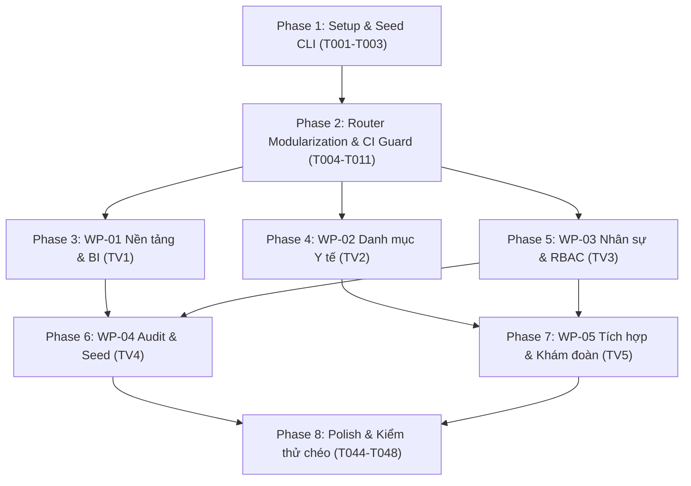

# Tasks: Phân hệ Quản trị viên (Admin Portal) theo chuẩn TClinic

**Input**: Design documents from `/specs/001-admin-portal-tclinic/`
**Prerequisites**: `plan.md`, `spec.md`, `research.md`, `data-model.md`, `contracts/`, `quickstart.md`
**Organization**: Tasks được phân chia theo 5 gói công việc độc lập (WP-01 đến WP-05) tương ứng với 5 thành viên để triển khai và kiểm thử song song.

---

## Format: `[ID] [P?] [WP?] Description`
- **[P]**: Có thể thực hiện song song (khác tệp, không phụ thuộc)
- **[WP]**: Gói công việc (WP01..WP05)
- Đường dẫn tệp tuyệt đối hoặc tương đối chuẩn xác từ gốc repository `clinic-ai/`

---

## Phase 1: Setup & Hạ tầng chung (Shared Infrastructure)

**Mục tiêu**: Chuẩn bị rào chắn kỹ thuật, phân định sở hữu tệp và công cụ seed dữ liệu mẫu.

- [ ] T001 [P] Khởi tạo tệp phân quyền sở hữu `.github/CODEOWNERS` gán trách nhiệm tệp cho 5 thành viên
- [ ] T002 [P] Xây dựng script CLI `clinic-ai/backend/scripts/seed_admin_demo.py` hỗ trợ cờ `--reset` và `--append` với 6 rào chắn an toàn
- [ ] T003 Viết kiểm thử tự động `clinic-ai/backend/tests/test_seed_admin_demo.py` xác minh tính lũy nghiệm (idempotency) và bảo tồn tài khoản người dùng

---

## Phase 2: Foundational (Module hóa Router & Rào chắn CI)

**Mục tiêu**: Tách nhỏ router `admin.py` thành các router con chuyên biệt và thiết lập rào chắn hồi quy `prRegressionGuard.test.mjs`.

- [ ] T004 Tạo cấu trúc thư mục module hóa `clinic-ai/backend/app/routers/admin/` và file điều phối `__init__.py`
- [ ] T005 [P] Khởi tạo khung router `clinic-ai/backend/app/routers/admin/admin_bi.py` (WP01)
- [ ] T006 [P] Khởi tạo khung router `clinic-ai/backend/app/routers/admin/admin_catalog.py` (WP02)
- [ ] T007 [P] Khởi tạo khung router `clinic-ai/backend/app/routers/admin/admin_staff.py` (WP03)
- [ ] T008 [P] Khởi tạo khung router `clinic-ai/backend/app/routers/admin/admin_audit.py` (WP04)
- [ ] T009 [P] Khởi tạo khung router `clinic-ai/backend/app/routers/admin/admin_integration.py` (WP05)
- [ ] T010 Đăng ký router tổng hợp `admin` vào `clinic-ai/backend/app/main.py`
- [ ] T011 Cập nhật `clinic-ai/fe/tests/prRegressionGuard.test.mjs` để bổ sung rào chắn kiểm thử tự động các route Admin cốt lõi

**Checkpoint**: Nền tảng phân tách router đã sẵn sàng. 5 thành viên có thể bắt đầu làm việc song song trên 5 gói công việc độc lập.

---

## Phase 3: Gói 1 (WP-01) — Điều hành BI, Nối Route chết & Tinh gọn Sidebar (Thành viên 1) 🎯 MVP

**Mục tiêu**: Xử lý an toàn Empty State cho Dashboard BI, nối lại 2 route chết và tinh gọn sidebar menu Admin.
**Trách nhiệm tệp**: `admin_bi.py`, `AdminTemplate.jsx`, `App.jsx`, `clinicSeed.json`, `DashboardAdminPage.jsx`, `GuideAndQaManagementPage.jsx`

### Kiểm thử cho Gói 1
- [ ] T012 [P] [WP01] Viết unit test `clinic-ai/backend/tests/test_admin_bi.py` kiểm tra API `/api/admin/bi/dashboard-stats` trả về số 0 khi DB rỗng
- [ ] T013 [P] [WP01] Bổ sung test kiểm tra route `/admin/huong-dan` và `/admin/hoi-dap` trong `clinic-ai/fe/tests/prRegressionGuard.test.mjs`

### Thực thi Gói 1
- [ ] T014 [WP01] Triển khai API `/api/admin/bi/dashboard-stats` và `/api/admin/bi/export-excel` trong `clinic-ai/backend/app/routers/admin/admin_bi.py`
- [ ] T015 [WP01] Cập nhật `clinic-ai/fe/src/pages/admin/DashboardAdminPage.jsx` xử lý Empty State (hiển thị số 0 rõ ràng, không sập khi DB rỗng)
- [ ] T016 [WP01] Kết nối lại route `/admin/huong-dan` và `/admin/hoi-dap` trỏ đến `clinic-ai/fe/src/pages/admin/GuideAndQaManagementPage.jsx` trong `clinic-ai/fe/src/App.jsx`
- [ ] T017 [WP01] Thực hiện 6 bước Audit và tinh gọn sidebar menu trong `clinic-ai/fe/src/services/admin/seed/clinicSeed.json` và `clinic-ai/fe/src/layouts/AdminTemplate.jsx`; phân loại chi tiết 6 menu thuộc nhóm `courses`: loại bỏ 3 menu lâm sàng/thao tác tuyến đầu (`Liệu trình`, `Hóa đơn`, `Lịch liệu trình`); đánh giá khả năng chuyển giao `Danh mục bài tập` và `Danh mục liệu trình mẫu` sang phạm vi WP-02 (`CatalogManagementPage.jsx`) và `Báo cáo liệu trình` tổng hợp ẩn danh sang WP-01 (`DashboardAdminPage.jsx`); không xóa máy móc các danh mục/báo cáo hợp lệ; các mục chưa đủ dữ liệu giữ trạng thái Chờ xác nhận/audit, không tự ý tạo route hay API mới

**Checkpoint Gói 1**: Dashboard BI chạy chuẩn với dữ liệu PostgreSQL thật, route chết được khôi phục, menu gọn gàng.

---

## Phase 4: Gói 2 (WP-02) — Danh mục Y tế, Bảng giá & Mẫu in TT32 (Thành viên 2)

**Mục tiêu**: Di trú dữ liệu danh mục y tế từ JSON sang PostgreSQL, bảo đảm tính bất biến của bảng giá, hợp nhất biểu mẫu in và đánh giá tiếp nhận danh mục bài tập / gói liệu trình mẫu vào phạm vi `CatalogManagementPage.jsx` hiện tại (không tạo module danh mục mới ngoài phạm vi).
**Trách nhiệm tệp**: `admin_catalog.py`, `CatalogManagementPage.jsx`, `TemplateManagementPage.jsx`, `ServicePackagesPage.jsx`

### Kiểm thử cho Gói 2
- [ ] T018 [P] [WP02] Viết test `clinic-ai/backend/tests/test_admin_catalog.py` kiểm tra CRUD dịch vụ và tính bất biến của lịch sử giá dịch vụ
- [ ] T019 [P] [WP02] Viết test chặn trùng mã bệnh ICD-10 trả về HTTP 409

### Thực thi Gói 2
- [ ] T020 [WP02] Xây dựng các endpoint CRUD Khoa, Buồng khám, Dịch vụ, Thuốc, ICD-10 trong `clinic-ai/backend/app/routers/admin/admin_catalog.py`
- [ ] T021 [WP02] Triển khai cơ chế cập nhật giá dịch vụ tạo bản ghi mới và giữ nguyên lịch sử giá trong `clinic-ai/backend/app/services/admin_service.py`
- [ ] T022 [WP02] Cập nhật `clinic-ai/fe/src/pages/admin/CatalogManagementPage.jsx` chuyển từ gọi kho JSON sang gọi trực tiếp API quan hệ PostgreSQL; đánh giá tiếp nhận danh mục bài tập và gói liệu trình mẫu trong phạm vi catalog hiện tại nếu được duyệt chuyển giao
- [ ] T023 [WP02] Hợp nhất giao diện quản lý biểu mẫu in ấn TT32 trong `clinic-ai/fe/src/pages/admin/TemplateManagementPage.jsx`
- [ ] T024 [WP02] Đồng bộ query parameter `?tab=` hai chiều cho component trong `clinic-ai/fe/src/pages/admin/ServicePackagesPage.jsx`

**Checkpoint Gói 2**: Danh mục y tế lưu trữ 100% trên PostgreSQL, bảng giá bất biến, mẫu in đồng bộ.

---

## Phase 5: Gói 3 (WP-03) — Quản trị Bác sĩ, CCHN, Phân ca & RBAC (Thành viên 3)

**Mục tiêu**: Quản lý hồ sơ bác sĩ kèm CCHN, chặn phân ca khi CCHN hết hạn, phát hiện xung đột buồng khám và siết chặt RBAC tại API.
**Trách nhiệm tệp**: `admin_staff.py`, `RolePermissionPage.jsx`, `SettingClinicPage.jsx`

### Kiểm thử cho Gói 3
- [ ] T025 [P] [WP03] Viết test `clinic-ai/backend/tests/test_admin_staff.py` kiểm tra chặn phân ca trực cho bác sĩ có CCHN hết hạn hoặc bị đình chỉ
- [ ] T026 [P] [WP03] Viết test kiểm tra phát hiện xung đột xếp trùng buồng khám hoặc trùng giờ trực trả về HTTP 409
- [ ] T027 [P] [WP03] Viết test gọi API admin bằng tài khoản không có quyền trả về HTTP 403 Forbidden

### Thực thi Gói 3
- [ ] T028 [WP03] Xây dựng CRUD Bác sĩ, Nhân sự và kiểm tra trạng thái CCHN trong `clinic-ai/backend/app/routers/admin/admin_staff.py`
- [ ] T029 [WP03] Triển khai logic kiểm tra xung đột buồng khám và thời gian ca trực trong `admin_staff.py`
- [ ] T030 [WP03] Tích hợp middleware kiểm tra quyền hạn chi tiết (Fine-grained Permissions) tại các endpoint admin
- [ ] T031 [WP03] Cập nhật giao diện quản trị phân quyền ma trận vai trò trong `clinic-ai/fe/src/pages/admin/RolePermissionPage.jsx`
- [ ] T032 [WP03] Hoàn thiện cấu hình thông số phòng khám và ca trực trong `clinic-ai/fe/src/pages/admin/SettingClinicPage.jsx`

**Checkpoint Gói 3**: An toàn phân quyền y tế được bảo đảm, CCHN được kiểm soát chặt chẽ, ca trực không bị xung đột.

---

## Phase 6: Gói 4 (WP-04) — Nhật ký Kiểm toán Y tế & Quản trị Dữ liệu Seed (Thành viên 4)

**Mục tiêu**: Giám sát nhật ký kiểm toán y tế append-only (NĐ 102/2025/NĐ-CP) và cung cấp bộ dữ liệu mẫu chuẩn cho toàn đội ngũ.
**Trách nhiệm tệp**: `admin_audit.py`, `ComplianceAndAuditPage.jsx`, `scripts/seed_admin_demo.py`

### Kiểm thử cho Gói 4
- [ ] T033 [P] [WP04] Viết test `clinic-ai/backend/tests/test_admin_audit.py` kiểm tra truy vấn log kiểm toán y tế phân trang và lọc theo actor/action
- [ ] T034 [P] [WP04] Viết test xác minh cờ `--reset` trên môi trường không hợp lệ bị chặn đứng ngay lập tức

### Thực thi Gói 4
- [ ] T035 [WP04] Triển khai API truy vấn nhật ký kiểm toán y tế append-only trong `clinic-ai/backend/app/routers/admin/admin_audit.py`
- [ ] T036 [WP04] Hoàn thiện giao diện hiển thị và tìm kiếm Audit Trail trong `clinic-ai/fe/src/pages/admin/ComplianceAndAuditPage.jsx`
- [ ] T037 [WP04] Hoàn thiện và chạy thử nghiệm `scripts/seed_admin_demo.py` để cấp phát bộ dữ liệu mẫu chuẩn cho 5 thành viên

**Checkpoint Gói 4**: Nhật ký kiểm toán y tế minh bạch, dữ liệu mẫu chuẩn hóa sẵn sàng cho việc test chéo.

---

## Phase 7: Gói 5 (WP-05) — Giám sát Đơn thuốc, Khám đoàn & Tách Liệu trình (Thành viên 5)

**Mục tiêu**: Giám sát hàng đợi đồng bộ đơn thuốc quốc gia, chuẩn hóa trang Khám đoàn (`CorporateHealthPage.jsx` chỉ quản lý danh mục gói/hợp đồng khám doanh nghiệp) và loại bỏ route `/admin/lieu-trinh`, `/admin/lieutrinh` khỏi Admin Portal theo Phương án A; bảo đảm Admin không truy cập component lâm sàng; không xây dựng workspace/API lâm sàng trong gói này.
**Trách nhiệm tệp**: `admin_integration.py`, `CorporateHealthPage.jsx`, `App.jsx`, `AdminTemplate.jsx`

### Kiểm thử cho Gói 5
- [ ] T038 [P] [WP05] Viết test `clinic-ai/backend/tests/test_admin_integration.py` kiểm tra API trạng thái đồng bộ đơn thuốc quốc gia
- [ ] T039 [P] [WP05] Bổ sung test kiểm tra route `/admin/kham-doan` trong `clinic-ai/fe/tests/prRegressionGuard.test.mjs`

### Thực thi Gói 5
- [ ] T040 [WP05] Xây dựng API giám sát hàng đợi và trạng thái đơn thuốc quốc gia trong `clinic-ai/backend/app/routers/admin/admin_integration.py`
- [ ] T041 [WP05] Kết nối lại route `/admin/kham-doan` và `/admin/dang-ky-doan` trỏ đến `clinic-ai/fe/src/pages/admin/CorporateHealthPage.jsx`
- [ ] T042 [WP05] Hoàn thiện giao diện quản trị khám sức khỏe đoàn trong `CorporateHealthPage.jsx`
- [ ] T043 [WP05] Loại bỏ các route `/admin/lieu-trinh` và `/admin/lieutrinh` trong `clinic-ai/fe/src/App.jsx` và `clinic-ai/fe/src/layouts/AdminTemplate.jsx`; loại bỏ các menu không thuộc Admin và bảo đảm Admin không thể truy cập component lâm sàng qua route khác; giới hạn nghiêm ngặt trong phạm vi dọn dẹp Admin, tuyệt đối không mở rộng xây dựng workspace/API mới cho Doctor/Staff/Cashier (việc phân rã TreatmentCoursePage.jsx cho các vai trò khác là backlog riêng ngoài WP-05)

**Checkpoint Gói 5**: Đơn thuốc quốc gia được giám sát chặt chẽ, khám đoàn được kết nối hoàn chỉnh.

---

## Phase 8: Polish, Test chéo & Nghiệm thu Tổng thể

**Mục tiêu**: Kiểm thử chéo giữa 5 thành viên, xác nhận Clean Code không comment và kiểm tra độ phủ test trước khi merge vào `develop`.

- [ ] T044 [P] Kiểm tra tự động bằng linter xác nhận 100% không chứa comment (`#`, `//`, `/* */`) và không chứa docstring trong toàn bộ tệp mới/sửa
- [ ] T045 Chạy toàn bộ test backend: `pytest clinic-ai/backend/tests`
- [ ] T046 Chạy toàn bộ test frontend: `npm --prefix clinic-ai/fe test` và `node clinic-ai/fe/tests/prRegressionGuard.test.mjs`
- [ ] T047 Kiểm thử chéo bàn giao: Mỗi thành viên kiểm thử một gói của thành viên khác theo Phiếu nghiệm thu 8 tiêu chí
- [ ] T048 Rebase và tạo Pull Request tổng kết merge vào nhánh `develop`

---

## Dependencies & Thứ tự Thực thi

- **Quy tắc làm việc song song**: Sau khi Phase 1 và Phase 2 hoàn thành, cả 5 thành viên có thể mở 5 branch tính năng riêng (`feature/admin-wp01` đến `feature/admin-wp05`) và tiến hành code độc lập mà không lo chạm file của nhau nhờ kiến trúc router module hóa và CODEOWNERS.
